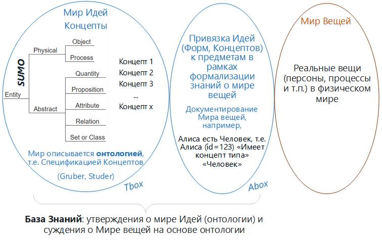
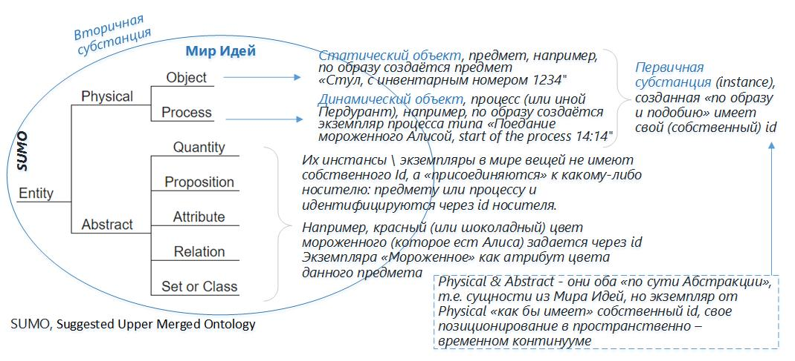
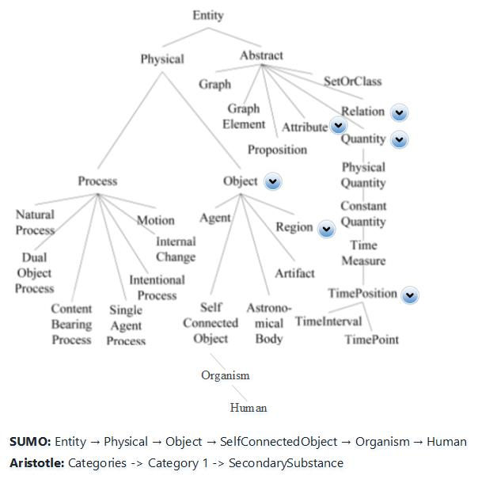

Ideas_and_Things.md

## The "World of Ideas and World of Things" Model
Онтология – раздел метаФизики (а она оаздел философии), но в той древней «философии-метафизики-онтологии» есть глобальная идея, которая сегодня составляет фундамент всей инженерии, включая онтологической.   
Модель «Мир идей и Мир вещей», включая под-модель «Мир идей» – под названием «Онтология» (Онтология = Спецификация концептов) придумали 2500 лет назад и ничего лучше пока нет.  
Все что сегодня есть в инженерии, от ООП \ программной инженерии до системной инженерии \ проектирования (СПДС\ЕСКД\ЕСПД\АС etc) – все это основано на платоновкой модели Мир идей \ Мир вещей, т.е. образы (концепты) и их копии – экземпляры (индивиды). САПР, моделирование процессов (BPM), исполняемый BPMN и т.п. 

Приведу несколько картинок:  
1 База Знаний  
 

2 Привязка к SUMO (Первичная / вторичная субстанция – это по Аристотелю)  


3 Фрагмент SUMO  


Если есть на схемах ошибки – подскажите.  

Модель «Мир идей и Мир вещей» Платона \ Аристотеля – это (пока) основа современной онтологии (метаОнтологии), во всяком случае «Онтологии сферы ИТ» - в первую очередь upper онтологии (SUMO etc).  
Добавлены теории, например, теория множеств, оформлено в разные формализмы, например, дескрипционные логики (DL: TBox\ABox), но сама суть осталась из античности.  
Если не так, то почему?  
Не онтологическое, а «обычное Инженерное» моделирование широко использует различение между типом (type, class, concept, template, master) и экземпляром (instance, individual).

Примеры Мира идей \ Мира вещей Платона в инженерии
Приведем аналогии в подтверждение тезиса, что это интуитивно понятный, простой и практичный платоновский концепт и используется повсеместно: создание копий (тень, инстанс, экземпляр, индивид) по шаблону (форме) или идентификация «объектов реального мира» на основе шаблона (универсалии, абстракции). 

### 1 OCR
Ранний OCR (Optical Character Recognition, оптическое распознавание текста) на template matching-подходе. 
На первом этапе (вначале) мы создаем шаблоны. Второй этап (целевой) – это идентификация экземпляра. Технологии OCR: при распознавании целевого текста посимвольно сравниваем с эталонными матрицами и таким образом идентифицируем символ, а если нет такого шаблона (символ другого алфавита, новый тип шрифта и т.п.), то необходимо сформировать новую матрицу и добавить в «World of Forms» нашего OCR.  
Интерпретация: человек смотрит на какую-либо пока не идентифицированную вещь, определяет ее ключевые параметры. По этому набору параметров находит схожий образ в «своем» Мире идей (сознании, памяти) и делает вывод об идентичности сущности из мира идей (образа) и сущности из мира вещей (экземпляре).   
Формулировка ИИ: «система выполняет классификацию наблюдения по обученному пространству признаков».  
Кроме OCR – много других примеров (и не столь мирных), тот же TERCOM.  

### 2 OOP
Это также семантическая основа инжиниринга, включая, классическое конструирование \ проектирование, systems engineering, software engineering (ООП, WfMS и др.).  
- Системная инженерия. Терминология и онтология https://rsq.narod.ru/lectures/systems_engineering_04.pdf  
- WfMS (исполняемый BPMN) https://habr.com/ru/articles/866822/ 

```
Пример «класс vs экземпляр класса» в ООП, OOP (Объектно-Ориентированное Программирование, Object-oriented programming) как противопоставление Мира идей (шаблонов \ чертежей) и Мира вещей (экземпляров \ реализаций):  
Самое простое объяснение: класс — это чертеж трансформера, а экземпляры этого класса — конкретные трансформеры, например, Оптимус Прайм или Олег.  
```
https://habr.com/ru/articles/463125

«Сравнительный анализ атрибутов ЖЦ программной инженерии и онтологического инжиниринга» показан в Таблице 1 из ПРОЕКТИРОВАНИЕ СИСТЕМ ПРОГРАММНОГО ОБЕСПЕЧЕНИЯ ПОД УПРАВЛЕНИЕМ ОНТОЛОГИЙ: МОДЕЛИ, МЕТОДЫ, РЕАЛИЗАЦИИ  
https://www.ontology-of-designing.ru/article/2019_4(34)/3_Khoroshevskiy.pdf

### 3 Visio
Редакторы схем с шаблонами (трафаретами)
В редакторах типа drawio, visio и т.п., а также инструментах класса BPM \ EA (Business Process Management \ Enterprise Architecture) при формировании схемы процесса \ системы из шаблона (справочника \ мира форм) мы мышкой перетаскиваем элементы (в другой мир) на схему, которые становятся экземплярами.  
Visio создаёт instance от master shape, т.е.  в визио при создании на схеме (условно) пятого прямоугольника id фигуры будет автоматически названо: «Прямоугольник.5», а шестого «Прямоугольник.6». Имя «Master-фигуры» + порядковый номер ее в схеме – т.е. «очередь экземпляра» соответствующего шаблона (Master-фигуры с именем «Прямоугольник»). Это пример формирования id экземпляра по id образа. 
