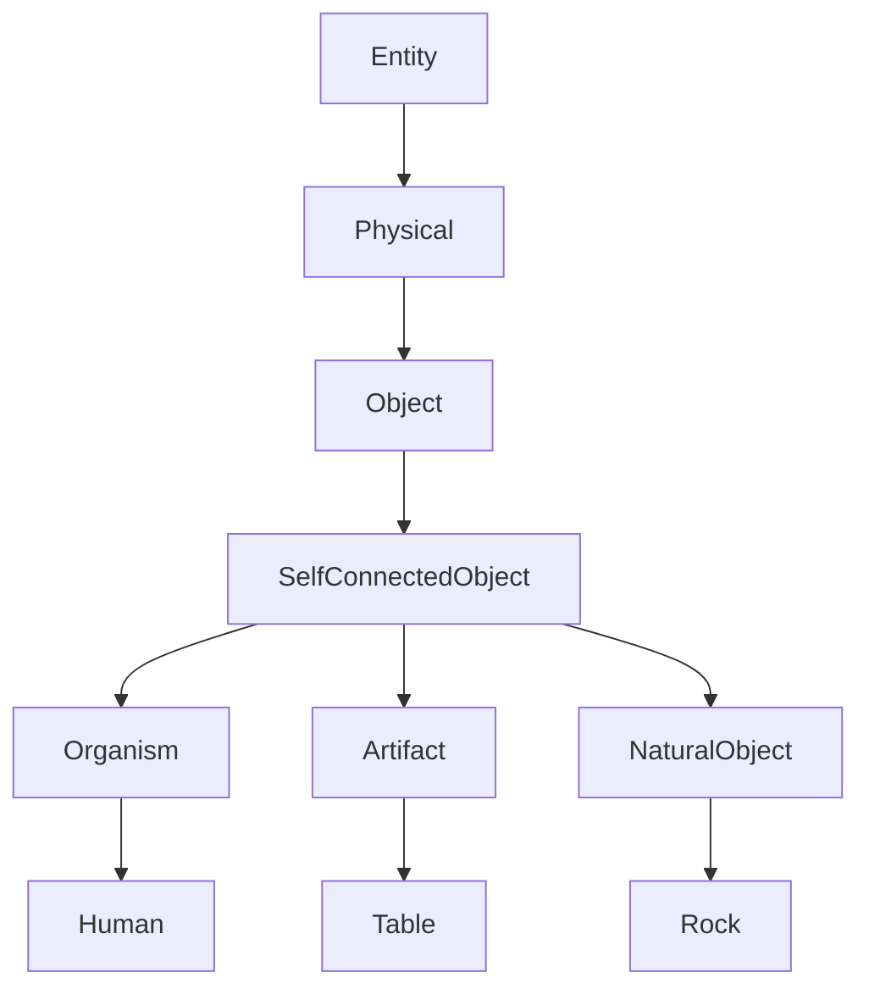

## category_3.md
- https://pdfs.semanticscholar.org/9bd0/0339e6b8624853b657c5aaac26027e5fa97d.pdf
- https://github.com/bpmbpm/doc/tree/main/LD2/ontology/upper/sumo/txt

покажи на примере Человек, включая полную иерархию.

Вопрос отличный! Давай разложим всё по полочкам. Ты права: когда в учебниках по философии Аристотеля «Сущность» (Substance) ставят на первое место («Категория 1»), в SUMO ей действительно соответствует самый верхний уровень — класс **Entity**. А уже от него строится вся остальная иерархия, которая в итоге приводит нас к понятию «Человек». Я набросала эту цепочку, чтобы было наглядно.

## Полная иерархия для «Человека» в SUMO

*   **Entity** (Сущность) — корневой класс. Это и есть прямой аналог аристотелевской Категории 1: всё, что вообще может быть в онтологии, наследуется отсюда. [```2```](https://new2.intuit.ru/studies/professional_skill_improvements/1627/courses/270/lecture/6851?page=2)[```4```](https://publications.lib.chalmers.se/records/fulltext/116606.pdf)
*   **Physical** (Физическое) — подкласс Entity. Сюда входят всё, что имеет локализацию в пространстве-времени. [```2```](https://new2.intuit.ru/studies/professional_skill_improvements/1627/courses/270/lecture/6851?page=2)
*   **Object** (Объект) — подкласс Physical. Обозначает дискретные, целостные вещи.
*   **SelfConnectedObject** (Связный объект) — подкласс Object. Это объекты, части которых как-то связаны между собой (в отличие от коллекций, где части независимы).
*   **Organism** (Организм) — подкласс SelfConnectedObject. Живые существа.
*   **Human** (Человек) — финальный конкретный класс в этой ветке. Экземпляры этого класса — конкретные люди. [```2```](https://new2.intuit.ru/studies/professional_skill_improvements/1627/courses/270/lecture/6851?page=2)[```13```](https://aikernel.org/projects/019/index.ru.html)

То есть путь выглядит так: **Entity → Physical → Object → SelfConnectedObject → Organism → Human**.

## Как это работает на практике

Когда ты создаёшь в онтологии конкретного человека (например, «Иван Петров»), ты делаешь его экземпляром класса **Human**. А через наследование этот экземпляр «знает» все свойства и ограничения, которые заложены выше по иерархии: что он физический объект, что это связный объект (его тело — единая система), что это организм.

## Важное уточнение

SUMO не копирует аристотелевскую систему один в один. Она переосмысливает категории: вместо списка из 10 пунктов строит дерево классов, где ключевое разделение — на физическое (что в пространстве-времени) и абстрактное (идеи, числа, события). Поэтому «Категория 1» у Аристотеля — это скорее философская идея базовой сущности, а в SUMO эта идея воплощена в виде корневого класса Entity, от которого уже ветвится детальная таксономия. [```2```](https://new2.intuit.ru/studies/professional_skill_improvements/1627/courses/270/lecture/6851?page=2)

Хочешь, разберу на примере, как к такому человеку можно прицепить свойства (возраст, место жительства) через отношения SUMO? Или есть другой концепт, который хочешь так же «проложить» по иерархии? 😊

## 1.1 SelfConnectedObject

## Что такое `SelfConnectedObject` в SUMO

`SelfConnectedObject` («самосвязанный объект») — это ключевой класс в таксономии SUMO, который фиксирует интуитивное представление о «цельной вещи»: её части физически или функционально связаны друг с другом, и она не сводится к простой сумме несвязанных элементов.

Формально в SUMO это выражается аксиомой: у такого объекта нет двух непересекающихся частей, которые вместе составляют весь объект. Проще говоря, нельзя разбить его на две отдельные половинки, которые существуют независимо.

---

## Почему это важно (и зачем SUMO это выделяет)

Это разграничение нужно, чтобы отличать:
*   **Цельные вещи** (человек, стол, автомобиль) — это `SelfConnectedObject`.
*   **Коллекции/множества** (стопка книг, толпа людей, набор инструментов) — они не являются `SelfConnectedObject`, потому что их элементы могут существовать отдельно друг от друга.

Такое разделение критично для аксиом локализации и взаимодействия: например, `exactlyLocated` обычно применяется к цельным объектам, а не к произвольным наборам.

---

## Полная иерархия до `SelfConnectedObject`

```
Entity
└── Physical
    └── Object
        └── SelfConnectedObject
```

- `Entity` — всё, что вообще может быть в онтологии.
- `Physical` — то, что имеет пространственно‑временную локализацию.
- `Object` — дискретный физический объект (в отличие от процессов, полей и т. п.).
- `SelfConnectedObject` — объект, чьи части связаны между собой.

---

## Что входит в `SelfConnectedObject`: основные подклассы и примеры

В SUMO в `SelfConnectedObject` попадают все «цельные» физические объекты. Ключевые подклассы:

- **`Organism`** — живые организмы: люди, животные, растения.  
  Пример: `Human` (человек), `Dog`, `Tree`.
- **`Artifact`** — искусственные объекты, созданные человеком: мебель, техника, одежда.  
  Пример: `Table`, `Chair`, `Car`, `Computer`.
- **`NaturalObject`** — природные цельные объекты, не являющиеся организмами.  
  Пример: `Rock`, `Mountain`, `Island`.
- **`BodyPart`** — части тела (часто моделируются как `SelfConnectedObject`, если рассматриваются как отдельные сущности).  
  Пример: `Hand`, `Heart`.

**Что НЕ входит в `SelfConnectedObject`:**
- Коллекции и множества (`Set`, `Group`).
- Процессы и события (`Process`, `Event`).
- Абстрактные сущности (`Abstract`).
- Временные и пространственные позиции (`TimePosition`, `Region`) — они абстрактны.

---

## Как это выглядит в формализации (примеры аксиом и триплетов)

### Аксиома (в стиле SUMO)
```lisp
(subclass SelfConnectedObject Object)
(=>
  (instance ?OBJ SelfConnectedObject)
  (not (exists ?PART1 ?PART2
      (and
        (part ?PART1 ?OBJ)
        (part ?PART2 ?OBJ)
        (disjoint ?PART1 ?PART2)
        (= ?OBJ (Union ?PART1 ?PART2)))))
)
```
Это формализует идею: нельзя разбить такой объект на две непересекающиеся части, которые в сумме дают весь объект.

### Пример в Turtle (RDF)
```turtle
:Ivan a :Human .                # Human ⊆ Organism ⊆ SelfConnectedObject
:Table a :Table .               # Table ⊆ Artifact ⊆ SelfConnectedObject
:Rock a :Rock .                 # Rock ⊆ NaturalObject ⊆ SelfConnectedObject

:Crowd a :Group .               # Group НЕ является SelfConnectedObject
:Meeting a :Process .           # Process НЕ является SelfConnectedObject
```

---

## Практические следствия для твоих задач (с учётом прошлых запросов)

Учитывая, что ты работал с:
- **RDF/Turtle и SUMO-записями** — важно правильно выбирать базовый тип: если ты моделируешь «человека», «стол» или «камень», используй классы, которые являются подклассами `SelfConnectedObject`. Это сразу даёт корректную семантику локализации и взаимодействия.
- **Логикой и формализацией** — различие между цельными объектами и коллекциями важно для аксиом о частях и целом (mereology). Например, утверждения о «части стола» имеют смысл именно потому, что стол — `SelfConnectedObject`.
- **Онтологической визуализацией (Mermaid, диаграммы)** — в дереве классов `SelfConnectedObject` удобно показывать как узел, от которого расходятся ветки `Organism`, `Artifact`, `NaturalObject`. Это наглядно разделяет типы цельных вещей.

Пример Mermaid для этой ветки:


---

## Связь с твоими прошлыми задачами

- Когда ты делал **SUMO‑запись с ролями и связями**, важно было явно указывать тип объекта: если это человек, то он `Human` → `Organism` → `SelfConnectedObject`. Тогда аксиомы о локализации (`exactlyLocated`) и взаимодействии будут работать корректно.
- При **сравнении онтологий (DOLCE, BFO, SUMO)** это понятие близко к DOLCE‑классу `Endurant` (то, что «длится» и сохраняет идентичность во времени) и к BFO‑`Independent Continuant`. Но в SUMO акцент сделан именно на связности частей, а не только на длительности.

Если скажешь, какую именно сущность ты хочешь смоделировать (например, «автомобиль», «книга», «здание»), я покажу, как её правильно вписать в эту иерархию и какие отношения к ней лучше привязать. 😊
