## 1

Ниже — максимально широкий обзор языков и формализмов для описания знаний, онтологий, правил, ограничений и семантических моделей. Важно различать **уровни**: логическое ядро → язык представления знаний → онтологический/веб-стандарт → язык запросов, правил или ограничений. SUO-KIF действительно является расширением KIF, созданным прежде всего для разработки SUMO. [ceur-ws](https://ceur-ws.org/Vol-938/ontobras-most2012_paper7.pdf)

## Базовые логические языки

Это «прародители» большинства онтологических языков: они задают синтаксис и модельную семантику, но обычно не являются готовыми инженерными языками моделирования.

| Семейство | Языки / формализмы | Что выражают | Наследники и применение |
|---|---|---|---|
| Пропозициональная логика | PL, SAT-формализмы | Булевы высказывания | Ограничения, верификация, SAT/SMT |
| Логика первого порядка | FOL / FOPC | Объекты, предикаты, функции, кванторы | KIF, Common Logic, IDEF5 elaboration language, многие онтологии  [cin.ufpe](https://www.cin.ufpe.br/~compint/aulas-IAS/artigos/CorchoPerez.pdf) |
| Логика высших порядков | HOL, second-order logic | Квантификация по предикатам и функциям | HOL, Isabelle/HOL, метамоделирование |
| Модальные и эпистемические логики | K, S4, S5, epistemic logic, deontic logic | Необходимость, знание, нормы, действия | BDI-агенты, нормативные модели, verification |
| Темпоральные логики | LTL, CTL, CTL*, TCTL | Время, последовательности состояний | Model checking, надежность, бизнес-правила |
| Немонотонные логики | Default logic, autoepistemic logic, circumscription | Вывод при неполной информации | KIF-расширения, rule systems  [ceur-ws](https://ceur-ws.org/Vol-352/paper3.pdf) |
| Пара-консистентные логики | Paraconsistent logic | Рассуждение при противоречиях | Интеграция разнородных знаний |
| Нечеткие и вероятностные логики | Fuzzy logic, ProbLog, Markov Logic Networks | Неопределенность, веса, вероятности | ML-онтологии, риск-анализ |
| Дескрипционные логики | ALC, SHIQ, SROIQ, EL, DL-Lite | Понятия, роли, иерархии, ограничения | KL-ONE, LOOM, OIL, DAML+OIL, OWL  [ceur-ws](https://ceur-ws.org/Vol-23/cranefield-ijcai99-iii.pdf) |
| Логика Хорна / логическое программирование | Prolog, Datalog, ASP | Правила, факты, рекурсия | SWRL, RIF, SHACL-расширения, экспертные системы |

Дескрипционные логики — разрешимые фрагменты логики первого порядка; именно баланс выразительности и вычислимости сделал их основой семейства OWL. [plato.stanford](https://plato.stanford.edu/archives/spr2026/entries/ontology-is/)

## Классические языки представления знаний

| Язык | Период | Парадигма | Роль и наследники |
|---|---|---|---|
| Semantic Networks | 1960-е | Сети узлов и связей | Предшественник фреймов и графовых моделей |
| Conceptual Graphs, CG | 1970-е–1980-е | Графовая FOL-нотация | CGIF, Common Logic  [ceur-ws](https://ceur-ws.org/Vol-352/paper3.pdf) |
| Frames | 1970-е | Объектно-фреймовое представление | KL-ONE, Ontolingua, F-logic, UML-профили |
| KL-ONE | 1980-е | Терминологическая логика | Прямой предок description logics, LOOM  [ceur-ws](https://ceur-ws.org/Vol-23/cranefield-ijcai99-iii.pdf) |
| LOOM | 1980-е–1990-е | Description-logic KR system | Потомок KL-ONE  [ceur-ws](https://ceur-ws.org/Vol-23/cranefield-ijcai99-iii.pdf) |
| KIF | 1992 | FOL-обмен, префиксный синтаксис | Ontolingua, SUMO/SUO-KIF, Common Logic  [pure.uva](https://pure.uva.nl/ws/files/763166/68629_07.pdf) |
| Ontolingua | 1990-е | Онтологическая надстройка над KIF | Ранние библиотеки онтологий  [pure.uva](https://pure.uva.nl/ws/files/763166/68629_07.pdf) |
| CycL | 1980-е–наст. время | FOL-подобный язык проекта Cyc | Массивная общая онтология и правила |
| F-logic | 1990-е | Фреймы + FOL + объектная модель | ObjectLogic, ранние Semantic Web rule languages  [cin.ufpe](https://www.cin.ufpe.br/~compint/aulas-IAS/artigos/CorchoPerez.pdf) |
| Conceptual Graph Interchange Format, CGIF | 1990-е–2000-е | Графовый синтаксис Common Logic | ISO Common Logic  [ceur-ws](https://ceur-ws.org/Vol-352/paper3.pdf) |
| Common Logic, CL | 2000-е | Семейство FOL-диалектов | CLIF, CGIF, XCL; ISO/IEC 24707  [webstore.iec](https://webstore.iec.ch/en/publication/63569) |
| CLIF | 2000-е | Текстовый диалект Common Logic | Обмен формальными онтологиями  [jfsowa](http://www.jfsowa.com/talks/clintro.pdf) |

KIF создавался как язык обмена знаниями между гетерогенными KR-системами и основан на логике первого порядка; SUO-KIF расширяет его для SUMO. [ceur-ws](https://ceur-ws.org/Vol-938/ontobras-most2012_paper7.pdf)

## Онтологические языки Semantic Web

Это наиболее стандартизованная ветвь: RDF задает графовую модель, RDFS — словарь классов и свойств, OWL — выразительную онтологическую логику, а SPARQL и SHACL — запросы и ограничения. [ebiquity.umbc](https://ebiquity.umbc.edu/_file_directory_/papers/190.pdf)

| Язык / стандарт | Год стандартизации | Назначение | Логическая основа |
|---|---:|---|---|
| SHOE | 1990-е | Ранние HTML-аннотации онтологиями | Простые рамки/онтологии  [en.wikipedia](https://en.wikipedia.org/wiki/DAML+OIL) |
| XOL | 1999 | XML-ориентированный онтологический обмен | Frame/DL-идеи  [en.wikipedia](https://en.wikipedia.org/wiki/DAML+OIL) |
| RDF | 1999; пересмотр 2004 | Триплеты «субъект—предикат—объект» | Графовая модель данных  [arxiv](https://www.arxiv.org/pdf/1608.03556.pdf) |
| RDFS | 1999; пересмотр 2004 | Классы, свойства, иерархии, домены/диапазоны | Слабая FOL-подобная семантика  [ebiquity.umbc](https://ebiquity.umbc.edu/_file_directory_/papers/190.pdf) |
| OIL | 2000 | Онтологический слой с DL-семантикой | Description Logic  [diag.uniroma1](http://www.diag.uniroma1.it/nardi/Didattica/RC/dispense/dlhb-14-2pp.pdf) |
| DAML | 2000 | DARPA Agent Markup Language | Ранний Semantic Web ontology language  [en.wikipedia](https://en.wikipedia.org/wiki/DAML+OIL) |
| DAML+OIL | 2001 | Объединение DAML и OIL | DL + RDF/RDFS  [ebiquity.umbc](https://ebiquity.umbc.edu/_file_directory_/papers/190.pdf) |
| OWL | 2004 | Полноценный W3C-язык онтологий | DL; профили OWL Lite, DL, Full  [ebiquity.umbc](https://ebiquity.umbc.edu/_file_directory_/papers/190.pdf) |
| OWL 2 | 2009; 2-е изд. 2012 | Профили EL, QL, RL; ключи, типы данных, аннотации | SROIQ-подобная DL  [w3](https://www.w3.org/OWL/) |
| SPARQL | 2008 | Запросы к RDF-графам | Графовые паттерны; SPARQL 1.1 — 2009/2013  [w3](https://www.w3.org/TR/) |
| RIF | 2009–2010 | Обмен правилами | Rule interchange; диалекты BLD, PRD, Core |
| SWRL | 2004 | Правила поверх OWL | Horn-like rules + OWL |
| SHACL | 2017 | Валидация и ограничения RDF-данных | Shapes, constraints; не полноценная DL  [w3](https://www.w3.org/groups/wg/data-shapes/publications/) |
| SHACL 1.2 | Развивается | Обновление правил и SPARQL-интеграции | Shapes / constraints  [w3](https://www.w3.org/TR/shacl12-sparql/) |

Линия развития здесь ясна: **RDF → RDFS → OIL/DAML → DAML+OIL → OWL → OWL 2**, а параллельно — **SPARQL** для запросов и **SHACL** для проверки данных. [diag.uniroma1](http://www.diag.uniroma1.it/nardi/Didattica/RC/dispense/dlhb-14-2pp.pdf)

## Языки правил и ограничений

| Язык | Связь с онтологиями | Основное назначение |
|---|---|---|
| Prolog | Логическое программирование | Факты, правила, рекурсивный вывод |
| Datalog | Дедуктивные БД, ограниченный Horn | Безопасные рекурсивные правила |
| Answer Set Programming, ASP | Non-monotonic reasoning | Дефолты, исключения, конфигурации |
| RuleML | XML-обмен правилами | Переносимость rule bases |
| RIF | W3C interchange | BLD, PRD, Core, FOL-диалект |
| SWRL | OWL + правила | Семантические правила над OWL |
| OCL | UML/MOF | Инварианты, пред- и постусловия, ограничения моделей  [scitepress](https://www.scitepress.org/papers/2004/26293/26293.pdf) |
| ALLOY | Structural modeling | Ограничения и анализ моделей |
| SQL CHECK / triggers | Реляционные данные | Ограничения целостности |
| SHACL | RDF data shapes | Валидация графов RDF  [w3](https://www.w3.org/groups/wg/data-shapes/publications/) |
| ShEx | RDF | Альтернативный язык shapes/валидации |
| SBVR | Бизнес- vocabularies и правила | Семантические бизнес-правила |
| DMN | Decision Model and Notation | Решения, таблицы решений, FEEL |
| Drools / rule engines | Исполнение правил | Операционные правила, Rete-вывод |

OCL не является онтологическим языком в строгом смысле: это язык ограничений для UML/MOF-моделей, но его активно используют для аксиом, инвариантов и сложных ограничений в онтологически ориентированном моделировании. [scitepress](https://www.scitepress.org/Papers/2004/26293/26293.pdf)

## Методологии и языки IDEF

IDEF5 — не один язык, а методология построения онтологий с двумя взаимодополняющими языками. [scitepress](https://www.scitepress.org/Papers/2004/26293/26293.pdf)

- **IDEF5 Schematic Language** — графо-схематический язык первичного захвата онтологии: виды, связи, процессы, роли, декомпозиции. [scitepress](https://www.scitepress.org/Papers/2004/26293/26293.pdf)
- **IDEF5 Elaboration Language** — более строгий язык для аксиом, ограничений и правил вывода; исторически опирается на KIF/FOL. [scitepress](https://www.scitepress.org/Papers/2004/26293/26293.pdf)
- **IDEF0** — функциональное моделирование, не онтологический язык, но часто источник понятий и процессов.
- **IDEF1X** — реляционное/ER-моделирование данных.
- **IDEF3** — моделирование процессов и сценариев.
- **IDEF14** — моделирование проектирования изделий и процессов.

## Инженерные и архитектурные языки

Они не всегда имеют формальную логическую семантику уровня OWL, но служат для концептуализации, ограничений и последующей формализации.

| Язык / нотация | Назначение | Онтологический статус |
|---|---|---|
| UML Class Diagrams | Классы, ассоциации, наследование | Концептуальная модель; может транслироваться в OWL |
| UML OCL | Ограничения UML-моделей | Формальные аксиомы/инварианты  [scitepress](https://www.scitepress.org/papers/2004/26293/26293.pdf) |
| MOF / Ecore | Метамоделирование | Основа DSL и модельной экосистемы |
| ER / EER | Сущности, связи, атрибуты | Предшественник онтологий данных |
| ORM / NORMA | Вербальная концептуальная модель | Богатая связь с фактами и ограничениями |
| ArchiMate | Архитектура предприятия | Частично формализуем через профили/онтологии |
| BPMN | Процессы | Процессная семантика, не DL-онтология |
| CMMN | Кейс-менеджмент | Гибкие процессы |
| SysML | Системная инженерия | Требования, структура, поведение |
| IFC | BIM-обмен | Отраслевая семантическая схема |
| STEP / EXPRESS | CAD/PLM data modeling | Формальный язык схем данных |
| Gellish | Инженерный словарь и факты | Формализованный технический язык |
| DOL | Distributed Ontology Language | Интеграция и модульность онтологий |

## Онтологические библиотеки и «родные» языки

| Проект | Язык | Комментарий |
|---|---|---|
| SUMO | SUO-KIF | SUO-KIF — расширение KIF, разработанное для SUMO.  [ceur-ws](https://ceur-ws.org/Vol-938/ontobras-most2012_paper7.pdf) |
| Cyc | CycL | Собственный выразительный логический язык проекта Cyc |
| DOLCE | OWL / DL | Формализация верхнеуровневой онтологии |
| BFO | OWL / DL | Верхнеуровневая онтология для биомедицины и инженерии |
| GFO | OWL / first-order theories | General Formal Ontology |
| SIO | OWL | Semanticscience Integrated Ontology |
| schema.org | RDF/RDFS + расширения | Практический веб-словарь |
| SKOS | RDF/RDFS | Тезаурусы, классификации, concept schemes |
| PROV-O | OWL/RDF | Происхождение данных и процессов |
| SOSA/SSN | OWL/RDF | Сенсоры, наблюдения, IoT |
| FIBO | OWL/SKOS | Финансовая индустрия |
| IOF Core | OWL | Промышленная онтология |
| ISO 15926 | EXPRESS/RDF-профили | Инженерные данные жизненного цикла |

## Специализированные семантические формализмы

- **Topic Maps** — темы, ассоциации, occurrence; исторический конкурент RDF для семантических навигационных моделей.
- **SKOS** — не полноценная онтология, а RDF-словарь для таксономий, тезаурусов и классификаторов.
- **FRBR / BIBFRAME** — библиотечно-библиографические семантические модели.
- **CIDOC CRM** — онтология культурного наследия.
- **SAREF** — онтология умных устройств и энергетики.
- **OGC standards** — GeoSPARQL, SensorThings, CityGML: пространственные и IoT-онтологии.
- **SBVR** — controlled natural language и бизнес-словари.
- **Controlled Natural Languages**: ACE, Attempto, Gellish English, Simpler English — читаемые человеком формы формальных знаний.
- **Knowledge Graph Embeddings** — TransE, ComplEx, RotatE: не языки описания, а векторные представления онтологий/графов.

## История развития

```mermaid
timeline
    title История языков описания знаний и онтологий
    section 1950-е–1960-е
        1956 : Logic Theorist
        1960-е : Semantic Networks
        1965 : Resolution и автоматическое доказательство
    section 1970-е
        1970-е : Frames, Minsky
        1970-е : Conceptual Graphs, Sowa
        1972 : Prolog
        1970-е : Semantic Web предпосылки
    section 1980-е
        1980-е : KL-ONE
        1980-е : Description Logics
        1984 : Cyc и CycL
        1980-е : LOOM
        1980-е : Expert systems и rule engines
    section 1990-е
        1992 : KIF
        1990-е : Ontolingua
        1990-е : F-logic
        1995 : IDEF5
        1997 : RDF-предпосылки
        1999 : RDF и RDFS
        1999 : OCL 1.x
    section 2000-е
        2000 : OIL
        2000 : DAML
        2001 : DAML+OIL
        2002 : OWL drafting
        2003 : ISO Common Logic work
        2004 : OWL W3C Recommendation
        2004 : SPARQL drafting
        2007 : ISO/IEC 24707 Common Logic
        2008 : SPARQL W3C Recommendation
        2009 : OWL 2
        2009 : RIF
    section 2010-е
        2012 : OWL 2 Second Edition
        2013 : SPARQL 1.1
        2014 : Knowledge graphs в индустрии
        2017 : SHACL W3C Recommendation
        2018 : ISO/IEC 24707:2018
    section 2020-е
        2020-е : Knowledge graphs, GQL, property graphs
        2020-е : Neuro-symbolic AI
        2020-е : SHACL 1.2 и развитие RDF-star
        2026 : Активная интеграция онтологий, LLM и enterprise knowledge graphs
```



## Ключевые линии преемственности

- **Semantic Networks → Frames → KL-ONE → Description Logics → OIL → DAML+OIL → OWL → OWL 2.** [ceur-ws](https://ceur-ws.org/Vol-23/cranefield-ijcai99-iii.pdf)
- **FOL → KIF → Ontolingua / SUO-KIF / IDEF5 elaboration language.** [ceur-ws](https://ceur-ws.org/Vol-938/ontobras-most2012_paper7.pdf)
- **KIF + Conceptual Graphs → Common Logic → CLIF, CGIF, XCL.** [ceur-ws](https://ceur-ws.org/Vol-352/paper3.pdf)
- **RDF → RDFS → OWL → OWL 2; SPARQL → SPARQL 1.1; SHACL → SHACL 1.2.** [w3](https://www.w3.org/TR/)
- **UML → OCL → формальные ограничения; UML profiles → OWL-онтологии.** [scitepress](https://www.scitepress.org/Papers/2004/26293/26293.pdf)
- **Frames → F-logic → ObjectLogic и rule-based semantic languages.** [cin.ufpe](https://www.cin.ufpe.br/~compint/aulas-IAS/artigos/CorchoPerez.pdf)

## Практическая карта выбора

- Для **формальной онтологии с выводом**: OWL 2 DL/EL/QL/RL, description logics, Common Logic.
- Для **общемировой онтологии и обмена**: KIF, SUO-KIF, CLIF, CGIF.
- Для **графовых данных и Linked Data**: RDF, RDFS, OWL, SKOS, SHACL, SPARQL.
- Для **правил и исключений**: SWRL, RIF, Datalog, ASP, RuleML.
- Для **ограничений в моделях**: OCL, SHACL, ALLOY, SBVR.
- Для **инженерных доменных моделей**: IDEF5, EXPRESS, IFC, SysML, ISO 15926, Gellish.
- Для **процессов и архитектуры**: BPMN, CMMN, ArchiMate, UML — с последующей формализацией через OCL, OWL или DOL.

## 2.1

Ниже — вертикальная история развития языков описания знаний и онтологий с ключевыми персоналиями, университетами и организациями. Даты указаны для появления/стандартизации ключевых результатов; многие направления развивались параллельно. [cdn.aaai](https://cdn.aaai.org/KR/2004/KR04-078.pdf)

## Вертикальная история

```text
1950-е–1960-е
│
├─ 1950-е
│  ├─ Newell & Simon, RAND Corporation / Carnegie Institute of Technology
│  │  └─ Logic Theorist, General Problem Solver: машинные рассуждения и поиск
│  └─ John McCarthy, Dartmouth / MIT / Stanford
│     └─ Формализация «Artificial Intelligence» и логического подхода к знанию
│
└─ 1960-е
   ├─ Ross Quillian, Carnegie Mellon University
   │  └─ Semantic Networks: понятия как узлы, отношения как дуги [45]
   ├─ Marvin Minsky, MIT
   │  └─ Идеи структурированного представления знаний, позднее развитые во frames
   └─ J. Alan Robinson
      └─ Resolution principle: основа автоматического доказательства теорем

1970-е
│
├─ 1972
│  └─ Alain Colmerauer & Philippe Roussel, University of Marseille / University of Aix-Marseille
│     └─ Prolog: логическое программирование, Horn clauses
│
├─ 1974–1975
│  └─ Marvin Minsky, MIT AI Laboratory
│     └─ Frames: объектно-ориентированные структуры со слотами и значениями [45]
│
└─ 1976–1984
   └─ John F. Sowa, IBM / SUNY
      └─ Conceptual Graphs: графовая форма логики первого порядка [45]

1980-е
│
├─ 1980-е
│  ├─ Ronald J. Brachman, Bell Labs / USC ISI
│  │  └─ KL-ONE: структурное наследование, концепты и роли
│  ├─ Hector Levesque, University of Toronto
│  │  └─ Теория знаний и рассуждений, совместно с Brachman
│  └─ Из KL-ONE вырастают terminological / description logics  [cs.ox.ac](https://www.cs.ox.ac.uk/ian.horrocks/Publications/download/2010/HoPa10a.pdf)
│
├─ 1984
│  └─ Douglas Lenat, Stanford / MCC / Cycorp
│     └─ Проект Cyc и язык CycL: масштабная общая онтология
│
├─ 1985–1990-е
│  └─ Robert MacGregor, USC Information Sciences Institute
│     └─ LOOM: практическая KR/DL-система, потомок KL-ONE  [cs.ox.ac](https://www.cs.ox.ac.uk/ian.horrocks/Publications/download/2010/HoPa10a.pdf)
│
└─ 1980-е–1990-е
   └─ DARPA, Stanford, USC ISI
      └─ Knowledge Sharing Effort: предпосылки KIF и Ontolingua  [arxiv](https://www.arxiv.org/pdf/1608.03556.pdf)

1990-е
│
├─ 1992
│  ├─ Michael Genesereth & Richard Fikes, Stanford University
│  │  └─ KIF — Knowledge Interchange Format, FOL-ориентированный язык обмена знаниями  [pdfs.semanticscholar](https://pdfs.semanticscholar.org/3cc7/9faec30a40fbd587dcf6906c7c3425e49c36.pdf)
│  └─ Thomas Gruber, Stanford University
│     └─ Ontolingua: онтологическая надстройка над KIF  [pdfs.semanticscholar](https://pdfs.semanticscholar.org/3cc7/9faec30a40fbd587dcf6906c7c3425e49c36.pdf)
│
├─ 1990-е
│  ├─ Michael Kifer, Stony Brook University
│  │  └─ F-logic: фреймы + объектная модель + логика первого порядка  [pure.uva](https://pure.uva.nl/ws/files/763166/68629_07.pdf)
│  └─ Georg Lausen, University of Freiburg
│     └─ Совместные работы по F-logic
│
├─ 1995
│  ├─ Knowledge Based Systems, Inc. (KBSI), College Station, Texas
│  ├─ Armstrong Laboratory, Wright-Patterson Air Force Base
│  └─ IDEF5 Ontology Description Capture Method:
│     schematic language + elaboration language [39][40][42]
│
├─ 1996–1999
│  ├─ W3C, под руководством Tim Berners-Lee
│  │  └─ Формирование идей Semantic Web
│  ├─ Ora Lassila, Nokia Research Center
│  │  └─ RDF: модель триплетов «субъект—предикат—объект»  [webstore.iec](https://webstore.iec.ch/en/publication/63569)
│  └─ 1999: RDF и RDFS становятся W3C Recommendations  [w3](https://www.w3.org/TR/)
│
└─ 1999
   └─ OMG / Jos Warmer & Anneke Kleppe
      └─ OCL: язык ограничений для UML-моделей  [w3](https://www.w3.org/2007/OWL/wiki/Ian_Horrocks)

2000–2004: рождение Semantic Web онтологий
│
├─ 2000
│  ├─ Ian Horrocks, University of Manchester
│  ├─ Dieter Fensel, Vrije Universiteit Amsterdam / University of Innsbruck
│  ├─ Frank van Harmelen, Vrije Universiteit Amsterdam
│  └─ OIL — Ontology Inference Layer:
│     DL + frames + XML/RDF; проект On-To-Knowledge, финансирование ЕС [33][34][36][44]
│
├─ 2000–2001
│  ├─ DARPA DAML Program
│  ├─ James Hendler, University of Maryland
│  ├─ Peter F. Patel-Schneider, Bell Labs / Nuance
│  └─ DAML-ONT: американская ветвь веб-онтологий [34][36]
│
├─ 2001
│  ├─ Объединение DAML-ONT и OIL
│  └─ DAML+OIL: первая DL-онтология, тесно связанная с RDF/RDFS  [jfsowa](http://www.jfsowa.com/talks/clintro.pdf)
│
├─ 2001
│  └─ Tim Berners-Lee, James Hendler, Ora Lassila
│     └─ Статья «The Semantic Web»: концептуальный манифест направления [45]
│
└─ 2004
   ├─ W3C Web Ontology Working Group
   ├─ Ian Horrocks, University of Manchester
   ├─ Peter F. Patel-Schneider, Bell Labs
   ├─ Deborah McGuinness, Stanford University
   └─ OWL становится W3C Recommendation 10 февраля 2004 г. [34][44]

2004–2012: зрелость OWL и логического обмена
│
├─ 2004
│  ├─ W3C RDF Data Access Working Group
│  └─ SPARQL: язык запросов к RDF; Recommendation — 15 января 2008 г.  [daml](https://www.daml.org/meetings/2004/12/pi/Bell_Labs_Univ_Manchester.pdf)
│
├─ 2007
│  ├─ ISO/IEC JTC 1
│  ├─ John F. Sowa, Chris Menzel, Pat Hayes и сообщество Common Logic
│  └─ ISO/IEC 24707: Common Logic — семейство диалектов CLIF, CGIF, XCL  [mkbergman](https://www.mkbergman.com/wp-content/themes/ai3v2/files/2010Posts/a-brief-survey-of-ontology-development-methodologies.pdf)
│
├─ 2007–2009
│  ├─ W3C OWL Working Group
│  ├─ Boris Motik, University of Oxford
│  ├─ Peter F. Patel-Schneider
│  ├─ Ian Horrocks
│  └─ OWL 2: профили EL, QL, RL; ключи, типы данных, расширенные аннотации  [mkbergman](https://www.mkbergman.com/906/a-brief-survey-of-ontology-development-methodologies/)
│
├─ 2009
│  └─ OWL 2 становится W3C Recommendation; второе издание — 2012 г.  [mkbergman](https://www.mkbergman.com/906/a-brief-survey-of-ontology-development-methodologies/)
│
└─ 2009–2010
   ├─ W3C RIF Working Group
   ├─ Christian de Sainte Marie, IBM
   ├─ Harold Boley, University of New Brunswick
   └─ RIF: Rule Interchange Format — обмен правилами между системами

2010-е: валидация, графы знаний и доменные онтологии
│
├─ 2013
│  └─ W3C
│     └─ SPARQL 1.1: расширенные запросы, агрегаты, обновления  [daml](https://www.daml.org/meetings/2004/12/pi/Bell_Labs_Univ_Manchester.pdf)
│
├─ 2014–2017
│  ├─ W3C Data Shapes Working Group
│  ├─ Holger Knublauch, TopQuadrant
│  ├─ Karen Coyle, библиотечное сообщество
│  └─ SHACL: Shapes Constraint Language, W3C Recommendation 20 июля 2017 г.  [cs.man.ac](http://www.cs.man.ac.uk/~horrocks/Slides/glasgow.pdf)
│
├─ 2012–2018
│  ├─ Barry Smith, University at Buffalo
│  ├─ Alan Ruttenberg, Yale University
│  └─ BFO и биомедицинские OWL-онтологии
│
├─ 2010-е
│  ├─ Nicola Guarino, ISTC-CNR, Italy
│  │  └─ DOLCE и формальная онтологическая инженерия
│  ├─ Michael Gruninger, University of Toronto
│  └─ TOVE / промышленные и экономические онтологии
│
└─ 2010-е
   └─ Google, Microsoft, IBM, Facebook, Amazon
      └─ Industrial knowledge graphs: Freebase/Google Knowledge Graph, DBpedia, Wikidata и др.

2020-е: графы, ограничения и нейросимволические системы
│
├─ 2020-е
│  ├─ W3C RDF-star / SPARQL-star community
│  │  └─ Метаданные о триплетах, вложенные утверждения
│
├─ 2020-е
│  ├─ W3C Data Shapes Working Group
│  └─ SHACL 1.2: развитие shapes, SPARQL-интеграции и валидации  [files.ifi.uzh](https://files.ifi.uzh.ch/ddis/iswc_archive/iswc/pps/web/2006/lsdis.cs.uga.edu/iswc06/workshop_tutorial/tutorial_parsia.pdf)
│
├─ 2020-е
│  ├─ ISO/IEC, W3C, OMG
│  └─ Интеграция OWL, SHACL, RDF-star, property graphs и GQL
│
└─ 2020-е
   ├─ Stanford, Oxford, MIT, TU Wien, Fraunhofer
   ├─ Palantir, Siemens, Bosch, SAP
   └─ Ontology-driven analytics, semantic digital twins,
      neuro-symbolic AI, LLM + knowledge graphs
```

## Основные персонажи по направлениям

| Направление | Ключевые деятели | Учреждения |
|---|---|---|
| Semantic networks | Ross Quillian | Carnegie Mellon University  [pdfs.semanticscholar](https://pdfs.semanticscholar.org/3cc7/9faec30a40fbd587dcf6906c7c3425e49c36.pdf) |
| Frames | Marvin Minsky | MIT  [pdfs.semanticscholar](https://pdfs.semanticscholar.org/3cc7/9faec30a40fbd587dcf6906c7c3425e49c36.pdf) |
| Conceptual Graphs | John F. Sowa | IBM, SUNY  [pdfs.semanticscholar](https://pdfs.semanticscholar.org/3cc7/9faec30a40fbd587dcf6906c7c3425e49c36.pdf) |
| KL-ONE и DL | Ronald J. Brachman, Hector Levesque | Bell Labs, USC ISI, University of Toronto  |
| KIF и Ontolingua | Michael Genesereth, Richard Fikes, Thomas Gruber | Stanford University  [pdfs.semanticscholar](https://pdfs.semanticscholar.org/3cc7/9faec30a40fbd587dcf6906c7c3425e49c36.pdf) |
| CycL | Douglas Lenat | MCC, Cycorp  [pdfs.semanticscholar](https://pdfs.semanticscholar.org/3cc7/9faec30a40fbd587dcf6906c7c3425e49c36.pdf) |
| F-logic | Michael Kifer, Georg Lausen | Stony Brook University, University of Freiburg  |
| IDEF5 | KBSI; техническое руководство Armstrong Laboratory | Knowledge Based Systems, Inc.; Wright-Patterson AFB  [segoldmine.ppi-int](https://segoldmine.ppi-int.com/node/44665) |
| RDF и Semantic Web | Tim Berners-Lee, Ora Lassila | W3C, MIT, Nokia Research Center  [pdfs.semanticscholar](https://pdfs.semanticscholar.org/3cc7/9faec30a40fbd587dcf6906c7c3425e49c36.pdf) |
| OIL / DAML+OIL / OWL | Ian Horrocks, Peter F. Patel-Schneider, Frank van Harmelen, Dieter Fensel, Deborah McGuinness | University of Manchester, VU Amsterdam, Bell Labs, Stanford, W3C  [cdn.aaai](https://cdn.aaai.org/KR/2004/KR04-078.pdf) |
| Common Logic | John F. Sowa, Chris Menzel, Pat Hayes | ISO/IEC JTC 1, SUNY, сообщество CL  |
| OWL 2 | Boris Motik, Ian Horrocks, Peter F. Patel-Schneider | University of Oxford, University of Manchester, W3C  |
| SPARQL и SHACL | W3C рабочие группы; Holger Knublauch | W3C, TopQuadrant  |
| Формальная онтология | Barry Smith, Nicola Guarino, Michael Gruninger | University at Buffalo, ISTC-CNR, University of Toronto |

## Сжатая генеалогия

```text
Semantic Networks (Quillian, 1960-е)
        │
        ├── Frames (Minsky, 1975)
        │       │
        │       └── KL-ONE (Brachman, 1980-е)
        │               │
        │               └── Description Logics
        │                       │
        │                       ├── LOOM (MacGregor)
        │                       ├── OIL (Horrocks, Fensel, van Harmelen, 2000)
        │                       ├── DAML+OIL (DARPA + EU, 2001)
        │                       └── OWL (W3C, 2004) → OWL 2 (2009)
        │
        └── Conceptual Graphs (Sowa, 1984)
                │
                └── CGIF → Common Logic / CLIF (ISO/IEC 24707)

First-Order Logic
        │
        ├── KIF (Genesereth & Fikes, 1992)
        │       ├── Ontolingua (Gruber, 1992)
        │       ├── SUO-KIF → SUMO (Niles & Pease)
        │       └── IDEF5 elaboration language (KBSI, 1995)
        │
        └── CycL (Lenat, 1984)

RDF / RDFS (W3C, 1999)
        │
        ├── OIL → DAML+OIL → OWL → OWL 2
        ├── SPARQL (2008) → SPARQL 1.1 (2013)
        ├── SWRL (2004)
        ├── RIF (2009–2010)
        └── SHACL (2017) → SHACL 1.2
```

## Важное уточнение

- **IDEF5** — это прежде всего методология онтологического анализа, реализованная KBSI по контракту для ВВС США; ее формальная часть опирается на идеи логики первого порядка и KIF-подобных представлений. [segoldmine.ppi-int](https://segoldmine.ppi-int.com/node/44665)
- **SUO-KIF** — не самостоятельный «язык-предок», а практическое расширение KIF, выбранное как носитель SUMO. 
- **OCL** принадлежит не линии онтологических логик, а линии модельно-ориентированных ограничений: UML/MOF → OCL; при этом OCL может использоваться для аксиом и ограничений онтологически ориентированных моделей.

## 1.2

не увидел Object Constraint Language (OCL)

Вы правы: в предыдущей вертикальной истории OCL был упомянут лишь строкой в 1999 г., без его собственной линии развития. Ниже — исправленный фрагмент с выделенной историей **Object Constraint Language (OCL)** и его местом в общей генеалогии.

## Вертикальная история OCL

```text
1980-е–начало 1990-х
│
├─ Eiffel, Bertrand Meyer
│  └─ Design by Contract:
│     предусловия, постусловия, инварианты
│
├─ Syntropy, Steve Cook & John Daniels
│  └─ Формальная объектная методология;
│     выражения и ограничения для объектных моделей [48][54][58]
│
└─ IBM Insurance Division
   └─ IBEL — Integrated Business Engineering Language,
      предшественник OCL [48][52][56]

1995
│
└─ Jos Warmer, IBM
   └─ Развитие IBEL в Object Constraint Language;
      OCL задуман как читаемый человеком язык
      бизнес-моделирования и ограничений [48][50][58]

1996–1997
│
├─ OMG Object Analysis & Design Task Force
│  └─ RFP на стандарт объектно-ориентированного
│     анализа и проектирования [48][58]
│
├─ IBM + ObjectTime Limited
│  └─ Совместное предложение, включающее OCL [48][58]
│
└─ 1997
   └─ OCL входит в предложение UML и становится
      частью стандарта UML 1.1, принятого OMG в ноябре 1997 г. [46][48][55][58]

1999
│
└─ Jos Warmer & Anneke Kleppe
   └─ Книга «The Object Constraint Language:
      Precise Modeling with UML»;
      OCL закрепляется как язык инвариантов,
      пред- и постусловий в UML [52][59]

2003–2006
│
├─ 2003
│  └─ OMG публикует спецификацию UML 2.0 OCL [46][53]
│
└─ 2006
   └─ OCL 2.0 становится самостоятельной OMG-спецификацией
      с явно определенной метамоделью [47][53]

2010–2014
│
├─ 2010
│  └─ OCL 2.2 [47]
│
├─ 2011
│  └─ OCL 2.3.1 [47]
│
└─ 2014
   └─ OCL 2.4 — версия, согласованная
      с UML 2.4.1 и MOF 2.4.1 [47][51]
```

## Кто создал OCL

| Роль | Персона / организация |
|---|---|
| Идейный предшественник | Steve Cook и John Daniels — методология Syntropy  [um](https://www.um.es/giisw/ocltools/ocl.htm) |
| Непосредственный создатель | Jos Warmer, IBM; развил IBEL в OCL  [um](https://www.um.es/giisw/ocltools/ocl.htm) |
| Соавтор и семантик OCL 2 | Anneke Kleppe, Klasse Objecten  [amazon](https://www.amazon.de/Object-Constraint-Language-Addison-Wesley-Technology/dp/0321179366) |
| Организационный дом | Object Management Group, OMG  [ethz](https://ethz.ch/content/dam/ethz/special-interest/infk/inst-infsec/information-security-group-dam/research/publications/pub2007/easst-glitches.pdf) |
| Интеграция в стандарт | UML Partners, IBM, ObjectTime Limited  [um](https://www.um.es/giisw/ocltools/ocl.htm) |

## Место OCL в классификации

OCL — это **не онтологический язык** и не язык описания знаний в смысле OWL/KIF, а **язык формальных ограничений и выражений** для моделей UML и MOF. Он используется для инвариантов, предусловий, постусловий, вычислимых атрибутов и well-formedness rules метамоделей. [ethz](https://ethz.ch/content/dam/ethz/special-interest/infk/inst-infsec/information-security-group-dam/research/publications/pub2007/easst-glitches.pdf)

```text
UML / MOF
   │
   ├── UML Class Diagrams
   │      └── структура классов, ассоциаций, наследования
   │
   └── OCL
          └── ограничения, инварианты,
              пред- и постусловия,
              правила корректности метамоделей
```

Его логическая природа ближе к **типизированной объектно-ориентированной логике первого порядка с навигационными выражениями**, чем к description logics. Поэтому корректная линия такая:

```text
Design by Contract / Syntropy / IBEL
        │
        └── OCL 1.x (IBM → OMG UML 1.1, 1997)
                │
                └── OCL 2.0 (2006)
                        │
                        └── OCL 2.4 (2014)
```

## Исправленная общая вертикаль

В общей хронологии строку OCL следует читать так:

```text
1995–1997
│
├─ 1995
│  └─ Jos Warmer, IBM
│     └─ OCL развивается из IBEL и методологии Syntropy [48][50][58]
│
├─ 1997
│  ├─ IBM и ObjectTime Limited включают OCL
│  │  в предложение OMG по UML [48][58]
│  └─ UML 1.1 принят OMG в ноябре 1997 г.;
│     OCL становится частью UML [46][55][58]
│
└─ 1999
   └─ Jos Warmer & Anneke Kleppe
      └─ Первая систематическая книга по OCL;
         OCL — стандартный язык ограничений UML [52][59]

2003–2014
│
├─ 2003
│  └─ UML 2.0 OCL Specification [46][53]
│
├─ 2006
│  └─ OCL 2.0 как отдельная OMG-спецификация [47][53]
│
└─ 2014
   └─ OCL 2.4, согласованный с UML 2.4.1 и MOF 2.4.1 [47][51]
```

Таким образом, в исходной классификации OCL относится к ветви **«языки ограничений и контрактов»**, а не к ветви **«онтологические логики»**: его соседи — Eiffel contracts, JML, ALLOY, SBVR и SHACL, тогда как OWL, KIF и Common Logic находятся в другой ветви. [ethz](https://ethz.ch/content/dam/ethz/special-interest/infk/inst-infsec/information-security-group-dam/research/publications/pub2007/easst-glitches.pdf)
