## 1

Ниже — максимально широкий обзор языков и формализмов для описания знаний, онтологий, правил, ограничений и семантических моделей. Важно различать **уровни**: логическое ядро → язык представления знаний → онтологический/веб-стандарт → язык запросов, правил или ограничений. SUO-KIF действительно является расширением KIF, созданным прежде всего для разработки SUMO. [ceur-ws](https://ceur-ws.org/Vol-938/ontobras-most2012_paper7.pdf)

## Базовые логические языки

Это «прародители» большинства онтологических языков: они задают синтаксис и модельную семантику, но обычно не являются готовыми инженерными языками моделирования.

| Семейство | Языки / формализмы | Что выражают | Наследники и применение |
|---|---|---|---|
| Пропозициональная логика | PL, SAT-формализмы | Булевы высказывания | Ограничения, верификация, SAT/SMT |
| Логика первого порядка | FOL / FOPC | Объекты, предикаты, функции, кванторы | KIF, Common Logic, IDEF5 elaboration language, многие онтологии  [cin.ufpe](https://www.cin.ufpe.br/~compint/aulas-IAS/artigos/CorchoPerez.pdf) |
| Логика высших порядков | HOL, second-order logic | Квантификация по предикатам и функциям | HOL, Isabelle/HOL, метамоделирование |
| Модальные и эпистемические логики | K, S4, S5, epistemic logic, deontic logic | Необходимость, знание, нормы, действия | BDI-агенты, нормативные модели, verification |
| Темпоральные логики | LTL, CTL, CTL*, TCTL | Время, последовательности состояний | Model checking, надежность, бизнес-правила |
| Немонотонные логики | Default logic, autoepistemic logic, circumscription | Вывод при неполной информации | KIF-расширения, rule systems  [ceur-ws](https://ceur-ws.org/Vol-352/paper3.pdf) |
| Пара-консистентные логики | Paraconsistent logic | Рассуждение при противоречиях | Интеграция разнородных знаний |
| Нечеткие и вероятностные логики | Fuzzy logic, ProbLog, Markov Logic Networks | Неопределенность, веса, вероятности | ML-онтологии, риск-анализ |
| Дескрипционные логики | ALC, SHIQ, SROIQ, EL, DL-Lite | Понятия, роли, иерархии, ограничения | KL-ONE, LOOM, OIL, DAML+OIL, OWL  [ceur-ws](https://ceur-ws.org/Vol-23/cranefield-ijcai99-iii.pdf) |
| Логика Хорна / логическое программирование | Prolog, Datalog, ASP | Правила, факты, рекурсия | SWRL, RIF, SHACL-расширения, экспертные системы |

Дескрипционные логики — разрешимые фрагменты логики первого порядка; именно баланс выразительности и вычислимости сделал их основой семейства OWL. [plato.stanford](https://plato.stanford.edu/archives/spr2026/entries/ontology-is/)

## Классические языки представления знаний

| Язык | Период | Парадигма | Роль и наследники |
|---|---|---|---|
| Semantic Networks | 1960-е | Сети узлов и связей | Предшественник фреймов и графовых моделей |
| Conceptual Graphs, CG | 1970-е–1980-е | Графовая FOL-нотация | CGIF, Common Logic  [ceur-ws](https://ceur-ws.org/Vol-352/paper3.pdf) |
| Frames | 1970-е | Объектно-фреймовое представление | KL-ONE, Ontolingua, F-logic, UML-профили |
| KL-ONE | 1980-е | Терминологическая логика | Прямой предок description logics, LOOM  [ceur-ws](https://ceur-ws.org/Vol-23/cranefield-ijcai99-iii.pdf) |
| LOOM | 1980-е–1990-е | Description-logic KR system | Потомок KL-ONE  [ceur-ws](https://ceur-ws.org/Vol-23/cranefield-ijcai99-iii.pdf) |
| KIF | 1992 | FOL-обмен, префиксный синтаксис | Ontolingua, SUMO/SUO-KIF, Common Logic  [pure.uva](https://pure.uva.nl/ws/files/763166/68629_07.pdf) |
| Ontolingua | 1990-е | Онтологическая надстройка над KIF | Ранние библиотеки онтологий  [pure.uva](https://pure.uva.nl/ws/files/763166/68629_07.pdf) |
| CycL | 1980-е–наст. время | FOL-подобный язык проекта Cyc | Массивная общая онтология и правила |
| F-logic | 1990-е | Фреймы + FOL + объектная модель | ObjectLogic, ранние Semantic Web rule languages  [cin.ufpe](https://www.cin.ufpe.br/~compint/aulas-IAS/artigos/CorchoPerez.pdf) |
| Conceptual Graph Interchange Format, CGIF | 1990-е–2000-е | Графовый синтаксис Common Logic | ISO Common Logic  [ceur-ws](https://ceur-ws.org/Vol-352/paper3.pdf) |
| Common Logic, CL | 2000-е | Семейство FOL-диалектов | CLIF, CGIF, XCL; ISO/IEC 24707  [webstore.iec](https://webstore.iec.ch/en/publication/63569) |
| CLIF | 2000-е | Текстовый диалект Common Logic | Обмен формальными онтологиями  [jfsowa](http://www.jfsowa.com/talks/clintro.pdf) |

KIF создавался как язык обмена знаниями между гетерогенными KR-системами и основан на логике первого порядка; SUO-KIF расширяет его для SUMO. [ceur-ws](https://ceur-ws.org/Vol-938/ontobras-most2012_paper7.pdf)

## Онтологические языки Semantic Web

Это наиболее стандартизованная ветвь: RDF задает графовую модель, RDFS — словарь классов и свойств, OWL — выразительную онтологическую логику, а SPARQL и SHACL — запросы и ограничения. [ebiquity.umbc](https://ebiquity.umbc.edu/_file_directory_/papers/190.pdf)

| Язык / стандарт | Год стандартизации | Назначение | Логическая основа |
|---|---:|---|---|
| SHOE | 1990-е | Ранние HTML-аннотации онтологиями | Простые рамки/онтологии  [en.wikipedia](https://en.wikipedia.org/wiki/DAML+OIL) |
| XOL | 1999 | XML-ориентированный онтологический обмен | Frame/DL-идеи  [en.wikipedia](https://en.wikipedia.org/wiki/DAML+OIL) |
| RDF | 1999; пересмотр 2004 | Триплеты «субъект—предикат—объект» | Графовая модель данных  [arxiv](https://www.arxiv.org/pdf/1608.03556.pdf) |
| RDFS | 1999; пересмотр 2004 | Классы, свойства, иерархии, домены/диапазоны | Слабая FOL-подобная семантика  [ebiquity.umbc](https://ebiquity.umbc.edu/_file_directory_/papers/190.pdf) |
| OIL | 2000 | Онтологический слой с DL-семантикой | Description Logic  [diag.uniroma1](http://www.diag.uniroma1.it/nardi/Didattica/RC/dispense/dlhb-14-2pp.pdf) |
| DAML | 2000 | DARPA Agent Markup Language | Ранний Semantic Web ontology language  [en.wikipedia](https://en.wikipedia.org/wiki/DAML+OIL) |
| DAML+OIL | 2001 | Объединение DAML и OIL | DL + RDF/RDFS  [ebiquity.umbc](https://ebiquity.umbc.edu/_file_directory_/papers/190.pdf) |
| OWL | 2004 | Полноценный W3C-язык онтологий | DL; профили OWL Lite, DL, Full  [ebiquity.umbc](https://ebiquity.umbc.edu/_file_directory_/papers/190.pdf) |
| OWL 2 | 2009; 2-е изд. 2012 | Профили EL, QL, RL; ключи, типы данных, аннотации | SROIQ-подобная DL  [w3](https://www.w3.org/OWL/) |
| SPARQL | 2008 | Запросы к RDF-графам | Графовые паттерны; SPARQL 1.1 — 2009/2013  [w3](https://www.w3.org/TR/) |
| RIF | 2009–2010 | Обмен правилами | Rule interchange; диалекты BLD, PRD, Core |
| SWRL | 2004 | Правила поверх OWL | Horn-like rules + OWL |
| SHACL | 2017 | Валидация и ограничения RDF-данных | Shapes, constraints; не полноценная DL  [w3](https://www.w3.org/groups/wg/data-shapes/publications/) |
| SHACL 1.2 | Развивается | Обновление правил и SPARQL-интеграции | Shapes / constraints  [w3](https://www.w3.org/TR/shacl12-sparql/) |

Линия развития здесь ясна: **RDF → RDFS → OIL/DAML → DAML+OIL → OWL → OWL 2**, а параллельно — **SPARQL** для запросов и **SHACL** для проверки данных. [diag.uniroma1](http://www.diag.uniroma1.it/nardi/Didattica/RC/dispense/dlhb-14-2pp.pdf)

## Языки правил и ограничений

| Язык | Связь с онтологиями | Основное назначение |
|---|---|---|
| Prolog | Логическое программирование | Факты, правила, рекурсивный вывод |
| Datalog | Дедуктивные БД, ограниченный Horn | Безопасные рекурсивные правила |
| Answer Set Programming, ASP | Non-monotonic reasoning | Дефолты, исключения, конфигурации |
| RuleML | XML-обмен правилами | Переносимость rule bases |
| RIF | W3C interchange | BLD, PRD, Core, FOL-диалект |
| SWRL | OWL + правила | Семантические правила над OWL |
| OCL | UML/MOF | Инварианты, пред- и постусловия, ограничения моделей  [scitepress](https://www.scitepress.org/papers/2004/26293/26293.pdf) |
| ALLOY | Structural modeling | Ограничения и анализ моделей |
| SQL CHECK / triggers | Реляционные данные | Ограничения целостности |
| SHACL | RDF data shapes | Валидация графов RDF  [w3](https://www.w3.org/groups/wg/data-shapes/publications/) |
| ShEx | RDF | Альтернативный язык shapes/валидации |
| SBVR | Бизнес- vocabularies и правила | Семантические бизнес-правила |
| DMN | Decision Model and Notation | Решения, таблицы решений, FEEL |
| Drools / rule engines | Исполнение правил | Операционные правила, Rete-вывод |

OCL не является онтологическим языком в строгом смысле: это язык ограничений для UML/MOF-моделей, но его активно используют для аксиом, инвариантов и сложных ограничений в онтологически ориентированном моделировании. [scitepress](https://www.scitepress.org/Papers/2004/26293/26293.pdf)

## Методологии и языки IDEF

IDEF5 — не один язык, а методология построения онтологий с двумя взаимодополняющими языками. [scitepress](https://www.scitepress.org/Papers/2004/26293/26293.pdf)

- **IDEF5 Schematic Language** — графо-схематический язык первичного захвата онтологии: виды, связи, процессы, роли, декомпозиции. [scitepress](https://www.scitepress.org/Papers/2004/26293/26293.pdf)
- **IDEF5 Elaboration Language** — более строгий язык для аксиом, ограничений и правил вывода; исторически опирается на KIF/FOL. [scitepress](https://www.scitepress.org/Papers/2004/26293/26293.pdf)
- **IDEF0** — функциональное моделирование, не онтологический язык, но часто источник понятий и процессов.
- **IDEF1X** — реляционное/ER-моделирование данных.
- **IDEF3** — моделирование процессов и сценариев.
- **IDEF14** — моделирование проектирования изделий и процессов.

## Инженерные и архитектурные языки

Они не всегда имеют формальную логическую семантику уровня OWL, но служат для концептуализации, ограничений и последующей формализации.

| Язык / нотация | Назначение | Онтологический статус |
|---|---|---|
| UML Class Diagrams | Классы, ассоциации, наследование | Концептуальная модель; может транслироваться в OWL |
| UML OCL | Ограничения UML-моделей | Формальные аксиомы/инварианты  [scitepress](https://www.scitepress.org/papers/2004/26293/26293.pdf) |
| MOF / Ecore | Метамоделирование | Основа DSL и модельной экосистемы |
| ER / EER | Сущности, связи, атрибуты | Предшественник онтологий данных |
| ORM / NORMA | Вербальная концептуальная модель | Богатая связь с фактами и ограничениями |
| ArchiMate | Архитектура предприятия | Частично формализуем через профили/онтологии |
| BPMN | Процессы | Процессная семантика, не DL-онтология |
| CMMN | Кейс-менеджмент | Гибкие процессы |
| SysML | Системная инженерия | Требования, структура, поведение |
| IFC | BIM-обмен | Отраслевая семантическая схема |
| STEP / EXPRESS | CAD/PLM data modeling | Формальный язык схем данных |
| Gellish | Инженерный словарь и факты | Формализованный технический язык |
| DOL | Distributed Ontology Language | Интеграция и модульность онтологий |

## Онтологические библиотеки и «родные» языки

| Проект | Язык | Комментарий |
|---|---|---|
| SUMO | SUO-KIF | SUO-KIF — расширение KIF, разработанное для SUMO.  [ceur-ws](https://ceur-ws.org/Vol-938/ontobras-most2012_paper7.pdf) |
| Cyc | CycL | Собственный выразительный логический язык проекта Cyc |
| DOLCE | OWL / DL | Формализация верхнеуровневой онтологии |
| BFO | OWL / DL | Верхнеуровневая онтология для биомедицины и инженерии |
| GFO | OWL / first-order theories | General Formal Ontology |
| SIO | OWL | Semanticscience Integrated Ontology |
| schema.org | RDF/RDFS + расширения | Практический веб-словарь |
| SKOS | RDF/RDFS | Тезаурусы, классификации, concept schemes |
| PROV-O | OWL/RDF | Происхождение данных и процессов |
| SOSA/SSN | OWL/RDF | Сенсоры, наблюдения, IoT |
| FIBO | OWL/SKOS | Финансовая индустрия |
| IOF Core | OWL | Промышленная онтология |
| ISO 15926 | EXPRESS/RDF-профили | Инженерные данные жизненного цикла |

## Специализированные семантические формализмы

- **Topic Maps** — темы, ассоциации, occurrence; исторический конкурент RDF для семантических навигационных моделей.
- **SKOS** — не полноценная онтология, а RDF-словарь для таксономий, тезаурусов и классификаторов.
- **FRBR / BIBFRAME** — библиотечно-библиографические семантические модели.
- **CIDOC CRM** — онтология культурного наследия.
- **SAREF** — онтология умных устройств и энергетики.
- **OGC standards** — GeoSPARQL, SensorThings, CityGML: пространственные и IoT-онтологии.
- **SBVR** — controlled natural language и бизнес-словари.
- **Controlled Natural Languages**: ACE, Attempto, Gellish English, Simpler English — читаемые человеком формы формальных знаний.
- **Knowledge Graph Embeddings** — TransE, ComplEx, RotatE: не языки описания, а векторные представления онтологий/графов.

## История развития

```mermaid
timeline
    title История языков описания знаний и онтологий
    section 1950-е–1960-е
        1956 : Logic Theorist
        1960-е : Semantic Networks
        1965 : Resolution и автоматическое доказательство
    section 1970-е
        1970-е : Frames, Minsky
        1970-е : Conceptual Graphs, Sowa
        1972 : Prolog
        1970-е : Semantic Web предпосылки
    section 1980-е
        1980-е : KL-ONE
        1980-е : Description Logics
        1984 : Cyc и CycL
        1980-е : LOOM
        1980-е : Expert systems и rule engines
    section 1990-е
        1992 : KIF
        1990-е : Ontolingua
        1990-е : F-logic
        1995 : IDEF5
        1997 : RDF-предпосылки
        1999 : RDF и RDFS
        1999 : OCL 1.x
    section 2000-е
        2000 : OIL
        2000 : DAML
        2001 : DAML+OIL
        2002 : OWL drafting
        2003 : ISO Common Logic work
        2004 : OWL W3C Recommendation
        2004 : SPARQL drafting
        2007 : ISO/IEC 24707 Common Logic
        2008 : SPARQL W3C Recommendation
        2009 : OWL 2
        2009 : RIF
    section 2010-е
        2012 : OWL 2 Second Edition
        2013 : SPARQL 1.1
        2014 : Knowledge graphs в индустрии
        2017 : SHACL W3C Recommendation
        2018 : ISO/IEC 24707:2018
    section 2020-е
        2020-е : Knowledge graphs, GQL, property graphs
        2020-е : Neuro-symbolic AI
        2020-е : SHACL 1.2 и развитие RDF-star
        2026 : Активная интеграция онтологий, LLM и enterprise knowledge graphs
```

## Ключевые линии преемственности

- **Semantic Networks → Frames → KL-ONE → Description Logics → OIL → DAML+OIL → OWL → OWL 2.** [ceur-ws](https://ceur-ws.org/Vol-23/cranefield-ijcai99-iii.pdf)
- **FOL → KIF → Ontolingua / SUO-KIF / IDEF5 elaboration language.** [ceur-ws](https://ceur-ws.org/Vol-938/ontobras-most2012_paper7.pdf)
- **KIF + Conceptual Graphs → Common Logic → CLIF, CGIF, XCL.** [ceur-ws](https://ceur-ws.org/Vol-352/paper3.pdf)
- **RDF → RDFS → OWL → OWL 2; SPARQL → SPARQL 1.1; SHACL → SHACL 1.2.** [w3](https://www.w3.org/TR/)
- **UML → OCL → формальные ограничения; UML profiles → OWL-онтологии.** [scitepress](https://www.scitepress.org/Papers/2004/26293/26293.pdf)
- **Frames → F-logic → ObjectLogic и rule-based semantic languages.** [cin.ufpe](https://www.cin.ufpe.br/~compint/aulas-IAS/artigos/CorchoPerez.pdf)

## Практическая карта выбора

- Для **формальной онтологии с выводом**: OWL 2 DL/EL/QL/RL, description logics, Common Logic.
- Для **общемировой онтологии и обмена**: KIF, SUO-KIF, CLIF, CGIF.
- Для **графовых данных и Linked Data**: RDF, RDFS, OWL, SKOS, SHACL, SPARQL.
- Для **правил и исключений**: SWRL, RIF, Datalog, ASP, RuleML.
- Для **ограничений в моделях**: OCL, SHACL, ALLOY, SBVR.
- Для **инженерных доменных моделей**: IDEF5, EXPRESS, IFC, SysML, ISO 15926, Gellish.
- Для **процессов и архитектуры**: BPMN, CMMN, ArchiMate, UML — с последующей формализацией через OCL, OWL или DOL.
