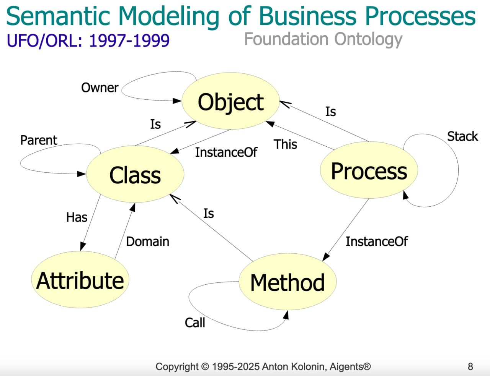

## link
## link 1
- https://t.me/rusontology/16233
  - https://github.com/aigents/iai/blob/main/docs/2025/ontologies-webstructor-aigents-2025.pdf Anton Kolonin
  - Тут идея такая, что есть абстрактный бизнес процесс (например, правила проведения сделки, на схеме называется "Method"), экземпляром которого являются реально исполняемые процессы (например, различные сделки, исполняемые в компании и находящиеся на различных этапах исполнения, на схеме называется "Process").
  - 
  - В этом смысле границы между объектами и процессами размываются. Счет более статичен (хотя его можно открыть и закрыть), контракт по счету заказчика более динамичен, запись о проводке по контракту вообще константна, хотя процесс ее исполнения вообще не фиксируется.
  - nevod1212
    - это различение "описание процесса / его исполнение", оно ортогонально паре объект / процесс. В нашей схеме Method - это допустимые состояния и переходы, а Process - конкретная цепочка состояний и событий одной сделки, этап сделки - ее текущее состояние.
    - Я бы только не называл это "экземпляром": экземпляр не может отклониться от класса, а сделка может пройти с нарушением регламента. Точнее сказать, что процесс исполняет метод. И сам метод тоже меняется, у него есть версии, так что это такой же объект с цепочкой состояний.
    - То, что у вас на схеме названо Method, у нас называется сценарием. Это модель процесса, и она входит в саму онтологию. Сценарием мы называем ее потому, что она описывает то, что может быть выполнено, и выполняется по заданной схеме. А результат выполнения - как раз цепочка состояний.
    - сейчас у “онтологов” это называется 4d-fluents 
  - Согласен, и в этой схеме границы как раз нет. Счет - объект с короткой цепочкой состояний (открыт, действует, закрыт), контракт - такой же объект с длинной. Проводка - объект-событие, поэтому она и константна: случившееся не меняется, ошибку исправляют сторно, то есть новым событием. А то, что процесс ее исполнения не фиксируется - выбор зернистости, для учета она атомарна. "Статичнее" и "динамичнее" тут означает только число переходов.
- https://golos.id/ru--upravlenie/@aigents/predstavlenie-sobytii-i-scenariev-prichinno-sledstvennyi-analiz-v-platforme-aigents
- https://arxiv.org/pdf/1807.02072
- Alexey Neznanov: https://hal.science/hal-05200765v1/file/ALFEDAGHI.pdf
## link2
- https://www.youtube.com/live/Wsfk3BDbZNg?is=CoCkeFMJ_svL9QWL Онтология процессов vs. Онтология объектов
- Alexander Boldachev
  - Событийная онтология vs объектная https://habr.com/ru/articles/706916/
  - Акты, классы и семантический сахар https://habr.com/ru/articles/708026/
  - Executable Ontologies: Synthesizing Event Semantics with Dataflow Architecture https://arxiv.org/abs/2509.09775
  - Subject-Event Ontology Without Global Time: Foundations and Execution Semantics https://arxiv.org/abs/2510.18040

## PSL
Psl (P Specification Language) вроде как три:
- Property 1850
- Process Iso 18629 - кстати там (включая  гост) есть определение онтологии - это в копилку определений онтологий
- Business psl (Business Process)

Однако к современному bpm они похоже отношения не имеют.  
Bpm - это как раз отражение процессо- ориентированности.  
"Большой bpm" на примере aris method reference с тысячами станиц описания классов (концептов) и предикатов. 
Или малый bpm, например, направление (составная часть)  workflow (http://www.workflowpatterns.com/).

    
## 1
https://t.me/rusontology/16235  
Большинство upper онтологий под object имеет статику (динамический обьект), а под process - динамику (динамический объект).
Пример sumo
https://www.slideserve.com/quin-elliott/4-1-sumo-sowa-s-ontology

В dolce, bfo и других upper (не всех) процесс зарыт чуть глубже (в условный пердурант), но смысл тот же (в sumo понятнее). 
Ветки эти (предмет / процесс) взаимоисключающие. 
И это верно: у них принципиально разный набор свойств, у процесса например, время начала и завершения, а у статического обьект такого нет. Время жизни / существования обьекта - это уже к свойствам процесса и его составным частям.

### nevod1212
#### 1.1 
ветки там правда непересекающиеся, но критерий не статика/динамика.  
Объект в каждый момент присутствует целиком, у процесса есть временные части. Объекты при этом меняются (человек стареет), а состояния в DOLCE лежат в пердурантах, хотя в них ничего не происходит. Время существования у объекта есть во всех трех онтологиях, нет только временных частей. И само взаимоисключение - выбор авторов: в 4D-онтологиях (ISO 15926, BORO) объект и процесс одного рода. Волна или ураган - объект или процесс? Зависит от задачи.

#### 1.2 
От дуализма можно уйти совсем. Объект - цепочка состояний, связанных событиями (сменами состояния), и все три вещи имеют временную протяженность. То, что мы называем объектом, - инвариант этой цепочки - критерий, по которому состояния считаются состояниями одного и того же. Так устроены 4D-онтологии (BORO, ISO 15926, Наша мета). Цена - нужно явно задать критерий тождества и зернистость событий, и то и другое выбирается под задачу.

на практике пока наиболее удобный способ моделирования сложных систем так как позволяет и работать с процессом целиком и уходить на кропускулярный уровень отдельных состояний

## also
- https://ontologforum.com/index.php/Ontology(IT)#MN95
  
## 2
https://t.me/rusontology/16263

От дуализма можно уйти совсем. Объект - цепочка состояний, связанных событиями (сменами состояния), и все три вещи имеют временную протяженность. То, что мы называем объектом, - инвариант этой цепочки - критерий, по которому состояния считаются состояниями одного и того же.

Не понял про дуализм. 
Object vs Process – это как черное vs белое. 
Объекты: человек, автомобиль, земля, книга и т.п. Возможно путаница (инвариант \ постоянство): состояние объекта vs состояние процесса.
Процессы: завтрак, ураган, изготовление табуретки, набор текста (как действие) и т.п.
Объекты создаются, меняют свои состояния (не путать состояние объекта и процесса), вплоть до разрушения \ уничтожения.
Процессы имеют два входа: событийный и вещевой и два выхода: событийный и вещевой. В ARIS идеологии (и другие ранние процессные методологии, включая IDEF и TQM) процесс = функция (действие, операция и т.п.).
Любой процесс имеет стартовое событие и финальное, по ним определяются начало и конец процесса. Особенно это хорошо видно в EPC (ссылку давал).  
Возвращаясь к SUMO. Взаимоисключающие ветки Object vs Process. Процесс имеет подветки (подклассы), например,
- NaturalProcess (Естественный процесс) – это природные явления, т.е. где актор, subject, исполнитель и т.п. – природа («творец»).
- AutomatedProcess (Автоматизированный процесс) – это как раз синоним бизнес-процесс, т.е. рукотворный, причем с уровнем автоматизации 0% – это полностью ручной процесс, а с уровнем 100% - это полностью автоматический и актор там «машина». Это кстати в ARIS \ EPC явно показано (через «sys»).

На базовом (примитивном) уровне процесс описывается через workflow – как строгая череда событий и функций (как в сетях Петри), т.е. двудольным графом. При дальнейшем усложнении добавляются исполнители, инструменты, входы \ выходы (вещевые) – и это все Объекты. 
Сам процесс – никак не Объект (конечно можно придумать разное и назвать "объектом", что и встречается обычно). У процесса есть состояния – это положения маркера (бегунка, метки) в заданный момент времени (причем маркер может быть только в функции, а в событии он не задерживается).
Итого: Процесс – это сущность из мира динамики, времени (временнОй составляющей), а объект (с его состояниями, например, составлен, подписан, согласован) – из мира статики, пространственной составляющей (у него нет времени). Процесс меняет Состояния  объекта (заготовка, изделие) и при этом фиксируется событие – тоже элемент процесса (мгновенная сущность).

Каждый объект привязан к процессу, полагаю, что без процесса он не существует (в Мире вещей). Видимо в этом и будет суть (будущей) процессно-ориентированной онтологии, когда объект будет обозначен как элемент процесса, но не сущность вне его. 
Создание экземпляра процесса – по аналогии с экземпляром объекта, т.е. через предикат instance. Как пример из автоматизации - создание экземпляра процесса в WF-engine (camunda, runa etc).       
Полагаю, что более фундаментального (логичного и взаимоувязанного), чем ARIS по идеологии (онтологии) процессов – вряд ли что-то есть. Если есть – покажите.  
Первая сотня [SUMO term:](http://sigma.ontologyportal.org/sigma/Graph.jsp)   
Ветка [Процесс в SUMO:](https://sigma.ontologyportal.org/sigma/Graph.jsp?relation=subclass&term=Process&up=1&down=1&limit=&inst=inst&fileRestrict=&columns=direct-children&columns=documentation&columns=graph&scrWidth=1258&kb=SUMO&flang=SUO-KIF&lang=EnglishLanguage&view=text&submit=submit)  
В DOLCE, BFO и др. тоже есть Process (иногда немного зарыта) и даже у некоторых как подкласс к Process есть Событие. Но все они далеки от ARIS – идеологии. 
Да, и SUMO - очень далека от идеала, но зато в ней наиболее точно показана развилка Physical. 

Вообще, если есть где что-то почитать про подобное, буду рад ссылкам. Особенно если есть пример типа «Процесс Изготовление табуретки» (hello world) – как иллюстрация сложной теории.
К примеру, из статьи выше: «Вода камень точит». Как по мне Актор – тут природа (природный процесс) и «Природа, используя инструмент Вода – точит воду». Но полагаю, что лучше концентрироваться именно на бизнес-процессах, а не природных (природных явлениях). 

Вообще видимо Процесс можно представить машиной Тьюринга. 

