## 1
Нужно найти подобные теории \ статьи \ обсуждения и предложить свой вариант теории.  
Мир делим на объекты и процессы, например как в онтологии SUMO (Object vs Process).  
Есть множество объектов и множество процессов. Есть пересечения этих множеств – т.е. использование одного экземпляра объекта в разных процессах (разных экземплярах как одного процесса, так и экземплярах разных процессов).   
В рамках процесса создается экземпляр объекта, меняется его состояния, вплоть до уничтожения \ удаления.  
Например, подписание заявления, стадии заявления (документа): создано заявление, согласовано заявление, утверждено заявление и т.п.   
Процесс – среда обработки объекта: создание \ изменение \ удаление. Причем разные процессы могут использовать (изменять состояния или просто считывать - читать) один и тот же экземпляр объекта.  
Возможно есть методы передачи объекта (документа, предмета, материала) из одного процесса в другой, также покажи другие возможные методы (манипуляции внутри процесса или между процессами по одному объекту, например, публикацию для всех других процессах, что был создан такой-то объект (экземпляр).  
Кроме поиска подобных обсуждений (онтологий процессного характера, т.к. объект – это порождение из процесса) покажи математическое представление этой идеи через множества. Как обработку внутри процесса (внутри процессные операции по изменению состояний объекта), так и меж процессную.  
 Формулы в Юникод (без Latex).  

---

Ваша идея очень близка к нескольким сложившимся направлениям: **процессным онтологиям** (BFO, PROV-O), **сетям Петри / workflow-моделям** и **событийно-ориентированным архитектурам** (event sourcing, saga/process manager). Ключевое уточнение вашей модели: объект не просто «участвует» в процессе, а имеет **жизненный цикл, порождаемый и изменяемый процессами**, и может быть одновременно вовлечён в несколько процессов.

## Близкие теории и модели

| Направление | Что берём | Чем отличается от вашей идеи |
|---|---|---|
| **BFO / SUMO** | Разделение на продолжающиеся сущности и происходящие сущности: объект сохраняет идентичность во времени, процесс является изменением участников. В BFO процесс — это occurrent, зависящий от материальных сущностей.  [ontology.buffalo](https://ontology.buffalo.edu/bfo/Reference/old%20versions/BFO_Nov20.docx) | Обычно объект первичен, а процесс описывает его изменения; у вас процесс может быть «средой», создающей и завершающей объект. |
| **PROV-O (W3C)** | Activity использует, создаёт и аннулирует Entity: `used`, `wasGeneratedBy`, `wasInvalidatedBy`; есть время генерации и время прекращения доступности.  [dvcs.w3](https://dvcs.w3.org/hg/prov/raw-file/tip/ontology/Overview.html) | Очень близко к вашей модели создания/уничтожения объекта процессом, но PROV ориентирован прежде всего на происхождение, а не на полный операционный язык манипуляций. |
| **Сети Петри и WF-net** | Токен — моделируемый объект или экземпляр дела; переход — активность; маркировка — снимок состояния; срабатывание перехода меняет распределение токенов.  [link.springer](https://link.springer.com/10.1007/978-3-030-26619-6_1) | Токен часто анонимен или дублируем; вам нужна идентичность экземпляра объекта, его атрибуты, история состояний и правила доступа из разных процессов. |
| **Petri nets with identifiers (PNID)** | Токены несут идентификаторы объектов; переходы могут порождать новые глобальные значения и отслеживать жизненный цикл объекта определённого типа.  [arxiv](https://arxiv.org/pdf/2112.14994v1.pdf) | Наиболее близкая формальная база для вашей идеи: объект сохраняет идентичность при переходе между процессами. |
| **Event sourcing** | Состояние сущности выводится из неизменяемой последовательности событий; текущее состояние — результат применения событий к исходному состоянию.  [github](https://github.com/palazer/architecture-patterns-kb/blob/main/patterns/data/event-sourcing.md) | Хорошо моделирует историю изменений объекта, но не задаёт онтологию самого процесса как среды обработки. |
| **Saga / Process Manager** | Координатор следит за событиями нескольких агрегатов и выдаёт команды; используется для долгих межагрегатных процессов и компенсаций.  [eventsourcing](https://www.eventsourcing.dev/best-practices/designing-aggregates) | Полезен для межпроцессных сценариев, но обычно это инженерный паттерн, а не общая онтологическая теория. |
| **OPM / Object-Process Methodology** | Система описывается через объекты, процессы, состояния и трансформации; процесс меняет состояние или порождает/уничтожает объекты. | Идеологически очень близко: стоит изучить OPM как практическую нотацию для вашей теории. |

## Предлагаемая теория: ПОМ

Назову её **Процессно-объектная модель (ПОМ)**.

Основной тезис: **объект — это идентифицируемый носитель состояния; процесс — это ограниченная среда допустимых операций над объектами; взаимодействие процессов происходит только через явно определённые операции передачи, публикации, блокировки, копирования или производные объекты.**

Ваш пример с заявлением укладывается так:

- Процесс `Согласование заявления` создаёт экземпляр `Заявление №17`.
- Внутри процесса меняются статусы: `создано → на согласовании → согласовано → утверждено`.
- Процесс `Архивирование` может получить ссылку на тот же экземпляр и перевести его в состояние `архивировано`.
- Процесс `Уведомление заявителя` может только читать объект и опубликовать факт `Заявление №17 утверждено`.

## Базовые множества

Обозначим:

- `O` — множество всех возможных типов объектов.
- `P` — множество всех типов процессов.
- `I` — множество идентификаторов экземпляров.
- `T` — упорядоченное множество моментов времени.
- `S` — множество всех состояний.
- `A` — множество атомарных операций.
- `E` — множество событий.
- `V` — множество значений атрибутов.

Экземпляр объекта в момент времени `t`:

`o(t) = (id, type, state, attrs, owner, version, lifecycle)`

где:

- `id ∈ I` — уникальный идентификатор;
- `type ∈ O` — тип объекта;
- `state ∈ S` — текущее состояние;
- `attrs : K → V` — функция атрибутов;
- `owner ∈ P ∪ {∅}` — процесс-владелец, если он есть;
- `version ∈ ℕ` — версия состояния;
- `lifecycle ⊆ S × S` — допустимые переходы состояний.

Множество всех экземпляров в момент `t`:

`Ω(t) = { o(t) | id ∈ I }`

Множество объектов, доступных процессу `p` в момент `t`:

`D(p, t) ⊆ Ω(t)`

## Процесс как среда обработки

Процесс-тип:

`p = (roles, stages, rules, operations, inputs, outputs)`

Экземпляр процесса:

`π(t) = (pid, ptype, stage, participants, context, activeObjects)`

где:

- `pid ∈ I` — идентификатор экземпляра процесса;
- `ptype ∈ P` — тип процесса;
- `stage ∈ Stages(p)` — текущая стадия;
- `participants` — агенты или роли;
- `context` — параметры запуска;
- `activeObjects ⊆ Ω(t)` — объекты, с которыми процесс сейчас работает.

Важно: **процесс не «содержит» объект как часть себя**. Он обладает правом выполнять над объектом определённые операции в пределах своей стадии и роли.

## Жизненный цикл объекта

Состояния объекта можно представить как конечный граф:

`G_o = (S_o, R_o)`

где:

- `S_o` — состояния объекта;
- `R_o ⊆ S_o × S_o` — допустимые переходы.

Для заявления:

`создано → на_согласовании → согласовано → утверждено → архивировано`

Операция внутри процесса:

`op(p, o, a, pre, post, effect)`

где:

- `p` — процесс-исполнитель;
- `o` — объект;
- `a ∈ A` — операция;
- `pre` — предусловие;
- `post` — постусловие;
- `effect` — функция перехода.

Изменение состояния:

`o′ = effect(o, a)`

Если операция допустима:

`pre(o, p, a) = true ⇒ o′ = effect(o, a)`

Иначе операция запрещена:

`pre(o, p, a) = false ⇒ o′ = o`

Пример:

`effect(утвердить, o) = o с state = утверждено и version = version + 1`

## Базовые операции над объектом

Внутри одного процесса:

- `create(p, type, attrs)` — создать новый экземпляр.
- `read(p, o)` — прочитать объект без изменения состояния.
- `update(p, o, attrs)` — изменить атрибуты.
- `transition(p, o, s′)` — перевести в новое состояние.
- `validate(p, o)` — проверить инварианты.
- `lock(p, o)` — захватить объект для исключительного изменения.
- `unlock(p, o)` — освободить объект.
- `clone(p, o)` — создать независимую копию с новым `id`.
- `version(p, o)` — создать новую версию того же объекта.
- `split(p, o)` — разделить объект на несколько объектов.
- `merge(p, o₁, o₂)` — объединить объекты.
- `attach(p, o, child)` — присоединить дочерний объект.
- `detach(p, o, child)` — отсоединить дочерний объект.
- `archive(p, o)` — перевести в неактивное, но сохраняемое состояние.
- `destroy(p, o)` — завершить жизненный цикл или сделать объект недоступным.

## Межпроцессные операции

Это главная часть вашей модели: объект может существовать в нескольких процессах, но не все процессы обязаны иметь одинаковые права.

### Передача владения

`handoff(p₁, p₂, o)`

Объект передаётся из процесса `p₁` в процесс `p₂`:

`owner(o′) = p₂`
`owner(o) = p₁ до операции`

Пример: согласованное заявление передаётся из процесса согласования в процесс утверждения.

### Делегирование

`delegate(p₁, p₂, o, rights)`

Процесс `p₁` сохраняет владение, но выдаёт процессу `p₂` ограниченные права:

`rights ⊆ {read, update, transition, sign, publish, archive}`

Пример: юридический отдел может читать и комментировать заявление, но не утверждать его.

### Совместное использование

`share(p₁, p₂, o, rights, duration)`

Оба процесса видят объект, но изменения регулируются правами и политикой конфликта:

`access(p, o) = rights`

Возможные политики:

- `last-writer-wins` — последняя запись перезаписывает предыдущую;
- `versioned` — каждая запись создаёт новую версию;
- `locked` — одновременно изменять может только один процесс;
- `append-only` — можно только добавлять события или комментарии;
- `read-only` — процесс может только читать.

### Публикация факта

`publish(p, o, event, audience)`

Процесс `p` не передаёт сам объект, а публикует событие о нём:

`event = (objectId, eventType, payload, timestamp, sourceProcess)`

Пример:

`publish(Согласование, Заявление №17, "заявление_утверждено", все_заинтересованные_процессы)`

Это соответствует идее domain events: другие агрегаты и процессы реагируют на событие, а не напрямую изменяют чужой объект. [github](https://github.com/palazer/architecture-patterns-kb/blob/main/patterns/data/event-sourcing.md)

### Подписка

`subscribe(p₂, p₁, eventPattern, handler)`

Процесс `p₂` получает уведомления о событиях процесса `p₁`:

`on event ∈ eventPattern ⇒ handler(p₂, event)`

Пример: процесс уведомлений подписан на событие `заявление_утверждено`.

### Производный объект

`derive(p₂, o, rule) → o′`

Процесс `p₂` создаёт новый объект на основе исходного:

`o′ = derive(o, rule)`
`o′.source = o.id`
`o′.createdBy = p₂`

Пример: из утверждённого заявления создаётся приказ, карточка дела или уведомление.

### Ссылка без владения

`reference(p₂, o)`

Процесс `p₂` хранит не копию объекта, а ссылку:

`ref = (objectId, versionAtRead, permissions)`

Это позволяет избежать расхождения копий: все процессы работают с одним экземпляром, но видят его через собственные проекции.

### Форк и слияние

`fork(p, o) → o₁, o₂`

Один объект порождает две независимые ветви:

`o₁.id ≠ o₂.id`
`o₁.parent = o.id`
`o₂.parent = o.id`

`merge(p, o₁, o₂, conflictPolicy) → o₃`

Ветви объединяются в новый объект или в новую версию:

`o₃ = merge(o₁, o₂, conflictPolicy)`

### Резервирование

`reserve(p, o, resource, interval)`

Процесс резервирует объект или ресурс на интервал времени:

`reservation = (objectId, processId, resource, interval)`

Пример: заявление резервируется для конкретного согласующего до конца рабочего дня.

## Математическая модель операций

Пусть операция — это частичная функция:

`a : Ω × P → Ω ∪ {⊥}`

где `⊥` означает «операция невозможна».

Для операции `a` в процессе `p` над объектом `o`:

`o′ = a(p, o)`

Операция допустима, если выполняются предусловия:

`pre(a, p, o) = true`

После операции меняется глобальное состояние системы:

`Ω(t′) = (Ω(t) \ {o}) ∪ {o′}`

Для операции создания:

`Ω(t′) = Ω(t) ∪ {o_new}`

Для уничтожения:

`Ω(t′) = Ω(t) \ {o}`
или, при мягком удалении:
`o′.state = удалён`

Для публикации объект не меняется, но добавляется событие:

`Ω(t′) = Ω(t)`
`E(t′) = E(t) ∪ {event}`

Для передачи:

`o′.owner = p₂`
`Ω(t′) = (Ω(t) \ {o}) ∪ {o′}`

Для совместного изменения:

`o′.version = o.version + 1`
`o′.history = o.history ∪ {change}`

## История объекта

Историю можно задать как последовательность событий:

`H(o) = (e₁, e₂, …, eₙ)`

где каждое событие:

`eᵢ = (tᵢ, pᵢ, aᵢ, o_before, o_after, actor, reason)`

Текущее состояние восстанавливается свёрткой:

`state(o, tₙ) = apply(…apply(apply(initialState, e₁), e₂)…, eₙ)`

Или компактно:

`state(o, tₙ) = fold(apply, initialState, H(o))`

Это прямо соответствует event sourcing: состояние является производным от неизменяемой цепочки фактов. [github](https://github.com/palazer/architecture-patterns-kb/blob/main/patterns/data/event-sourcing.md)

## Правила согласованности

Нужны инварианты:

1. **Идентичность:**  
   `id(o) = id(o′) ⇒ o и o′ — версии одного объекта`.

2. **Однозначность владельца:**  
   `owner(o) ∈ P ∪ {∅}`.

3. **Запрет недопустимого перехода:**  
   `(s, s′) ∉ R_o ⇒ transition(o, s′) = ⊥`.

4. **Право на операцию:**  
   `a ∈ rights(p, o) ⇒ a(p, o) разрешена`.

5. **Причинность событий:**  
   `event.generatedBy = p` и `event.objectId = o.id`.

6. **Невозможность изменения после уничтожения:**  
   `state(o) = уничтожен ⇒ ∀a ≠ read: a(p, o) = ⊥`.

7. **Конфликт версий:**  
   `o.version ≠ expectedVersion ⇒ update(p, o) = conflict`.

## Пример: заявление

Пусть есть три процесса:

- `P₁ = Согласование`
- `P₂ = Утверждение`
- `P₃ = Уведомление`

Последовательность:

1. `create(P₁, Заявление, attrs)`  
   Результат: `Заявление №17, state = создано`.

2. `transition(P₁, o, на_согласовании)`  
   Результат: `state = на_согласовании`.

3. `handoff(P₁, P₂, o)`  
   Результат: `owner = P₂`.

4. `transition(P₂, o, утверждено)`  
   Результат: `state = утверждено, version + 1`.

5. `publish(P₂, o, заявление_утверждено, audience = P₃)`  
   Объект не меняется, но появляется событие.

6. `subscribe(P₃, P₂, заявление_утверждено, sendNotification)`  
   Процесс уведомлений читает объект и создаёт производный объект `Уведомление №42`.

## Что стоит добавить в вашу теорию

Чтобы модель стала практичной, я бы добавил четыре понятия:

- **Права доступа:** не достаточно разделить объекты и процессы; нужно явно задать, кто может читать, менять, утверждать, публиковать и уничтожать.
- **Версии и события:** состояние объекта должно быть отделимо от его истории; это позволяет аудиту, откату и восстановлению.
- **Владение и ссылки:** объект может иметь владельца, но другие процессы могут работать с ним по ссылке или через события.
- **Политики конфликтов:** когда два процесса одновременно меняют один объект, система должна знать, что делать: блокировать, версионировать, объединять или отклонять изменение.

## Практическая основа для реализации

Наиболее удачная комбинация для вашей теории:

- **Онтологический слой:** BFO или SUMO для различения объекта и процесса. BFO явно противопоставляет продолжающиеся сущности и происходящие сущности, а процесс определяет как изменение участников. [ontology.buffalo](https://ontology.buffalo.edu/bfo/Reference/old%20versions/BFO_Nov20.docx)
- **Слой происхождения:** PROV-O для `used`, `wasGeneratedBy`, `wasInvalidatedBy`, времени создания и прекращения существования. [dvcs.w3](https://dvcs.w3.org/hg/prov/raw-file/tip/ontology/Overview.html)
- **Слой исполнения:** сети Петри с идентификаторами объектов, где токен несёт `id` и состояние объекта. [inf.unibz](https://www.inf.unibz.it/~montali/teaching/1415/dpm/slides/9.formal-analysis.pdf)
- **Слой истории:** event sourcing: события неизменяемы, состояние выводится из них. [github](https://github.com/palazer/architecture-patterns-kb/blob/main/patterns/data/event-sourcing.md)
- **Слой координации:** process manager / saga для передач, подписок, компенсаций и долгих межпроцессных сценариев. [eventsourcing](https://www.eventsourcing.dev/best-practices/designing-aggregates)

Таким образом, вашу идею можно сформулировать так: **объект — это устойчивый идентифицируемый узел состояния; процесс — это авторизованная среда операций; событие — атомарный факт изменения или публикации; а межпроцессное взаимодействие — это управляемый набор передач, ссылок, подписок, производных объектов и политик разрешения конфликтов.**

## 1.1 link
- https://dvcs.w3.org/hg/prov/raw-file/tip/ontology/Overview.html **Модель данных PROV** [ PROV-DM ] представляет собой набор концепций для представления информации о происхождении данных в различных областях применения. В этом документе приведено сопоставление модели данных PROV с онтологией PROV с использованием языка онтологий OWL2 [ OWL2-OVERVIEW ].  
Мы кратко представим некоторые термины моделирования OWL2, которые будут использоваться для описания онтологии PROV. Экземпляр OWL2 — это отдельный объект в предметной области, например, человек по имени Алиса или автомобиль по имени KITT. Набор объектов, обладающих общими характеристиками, образует класс . Person и Car — примеры классов, представляющих наборы отдельных людей и автомобилей соответственно. Свойства объектов OWL2 используются для связывания объектов, классов или создания иерархии свойств. Например, свойство объекта "hasOwner" можно использовать для связывания автомобиля с человеком. Свойства типов данных OWL2 используются для связывания объектов или классов со значениями данных, включая типы данных XML Schema [ XMLSCHEMA11-2 ].  


## 2
1 Расшифруй: 
Таким образом, вашу идею можно сформулировать так: объект — это устойчивый идентифицируемый узел состояния; процесс — это авторизованная среда операций; событие — атомарный факт изменения или публикации; а меж процессное взаимодействие — это управляемый набор передач, ссылок, подписок, производных объектов и политик разрешения конфликтов.

2 Если добавить еще "Множество состояний", то это видимо усложнит теорию? Также не понятно - одно событие может быть в разных процессах. Однако в каждом процесс - конечный набор событий. Более того, разные процессы могут иметь одни и теже операции (функции в ARIS). Покажи варианты учета событий.

3 Снабжай рассуждения схемами в mermaid (в названии узлов не должно быть скобок и кавычек). Проиллюстрируй ранее указанные операции (внутри и меж процессные) и свои новые предложения.  

---

Да, вы правы по всем четырём пунктам. Ссылка действительно устарела; корректнее опираться на актуальный репозиторий BFO и его спецификацию. В BFO объект — это **continuant** (сохраняет идентичность во времени), а процесс — **occurrent** (развертывается во времени и зависит от участвующих continuant’ов). [ontology.buffalo](https://ontology.buffalo.edu/smith/articles/Functions-in-BFO.pdf)

Ниже я уточняю модель и убираю из неё избыточность: **множество состояний не обязательно делать глобальным**; лучше сделать его локальным для типа объекта, а события — общими фактами, которые разные процессы могут по-разному интерпретировать.

## 1. Исправленная ссылка на BFO

Старый файл `BFO_Nov20.docx` недоступен. Актуальная точка входа — сайт BFO: [https://ontology.buffalo.edu/bfo/](https://ontology.buffalo.edu/bfo/) , а спецификация BFO 2.0 размещена в репозитории `BFO-ontology/BFO`. [ontology.buffalo](https://ontology.buffalo.edu/smith/articles/Functions-in-BFO.pdf)

Ключевые понятия BFO:

- `Continuant` — сущность, сохраняющая идентичность во времени: объект, качество, роль.
- `Occurrent` — сущность, имеющая временные части: процесс, событие, начало и завершение процесса.
- Процесс зависит от участвующих в нём continuant’ов; объект участвует в процессе. [ontology.buffalo](https://ontology.buffalo.edu/smith/articles/Material_Entities.pdf)

В вашей модели это соответствует следующему:

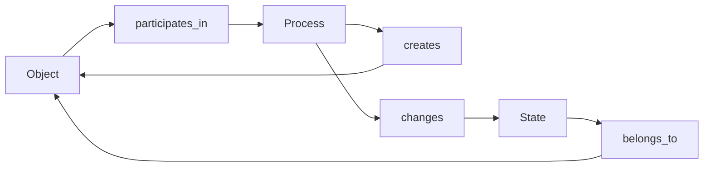

Но BFO не решает инженерные вопросы владения, ссылок, подписок и конфликтов. Для этого нужна дополнительная модель — ваша ПОМ.

## 2. Что такое «владелец»

**Владелец — это не обязательно процесс.** Это более точно назвать **контролирующим субъектом или ответственностью**, а не «владением» в бытовом смысле.

У объекта могут быть несколько независимых ролей:

| Роль | Кто может быть носителем | Что означает |
|---|---|---|
| `custodian` | Пользователь, отдел, система, организация | Кто отвечает за существование и целостность объекта |
| `responsibleProcess` | Экземпляр процесса | Какой процесс сейчас ведёт жизненный цикл объекта |
| `author` | Пользователь или система | Кто создал объект |
| `editor` | Пользователь, роль, процесс | Кто имеет право изменять |
| `reader` | Пользователь, роль, процесс | Кто может читать |
| `approver` | Пользователь или роль | Кто может перевести в утверждающее состояние |
| `notifiedParty` | Пользователь, процесс, система | Кого уведомляют о событии |

Пример заявления:

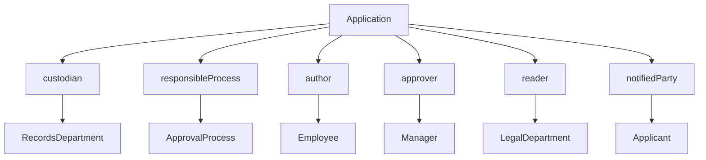

То есть в предыдущем ответе выражение:

`owner(o) = p`

было слишком сильным. Лучше использовать отношение **ответственности процесса**:

`responsibleFor(p, o)`

Оно означает: *экземпляр процесса `p` в данный момент уполномочен вести объект `o` по определённым правилам*, но не обязательно является его единственным «хозяином».

Формально:

`responsibleFor : P × O × T → Bool`

где:

- `P` — множество процессов;
- `O` — множество объектов;
- `T` — моменты времени.

Например:

`responsibleFor(Согласование_заявления, Заявление_17, t₁) = true`  
`responsibleFor(Утверждение_заявления, Заявление_17, t₂) = true`

При этом юридический отдел может иметь лишь право чтения:

`can(Юридический_отдел, Заявление_17, read) = true`  
`can(Юридический_отдел, Заявление_17, update) = false`

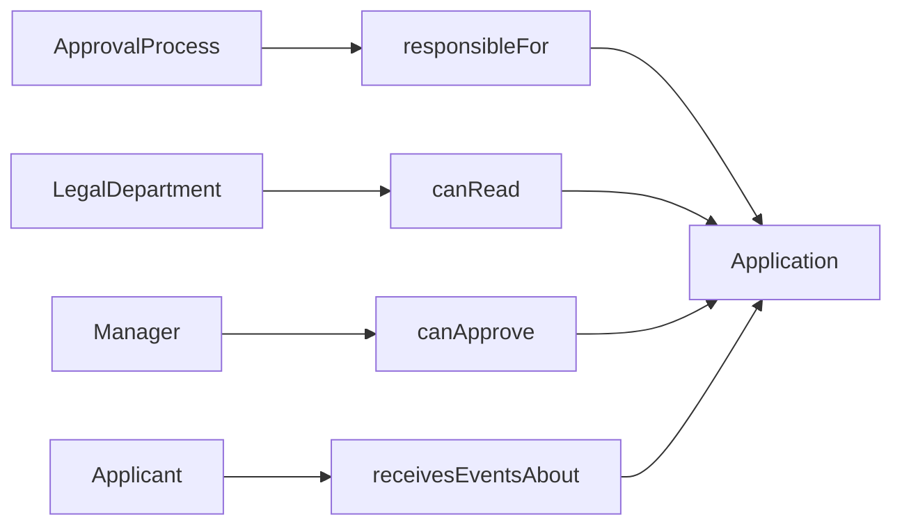

**Вывод:** слово «владелец» лучше заменить на `custodian` или `responsibleProcess`. Владелец отвечает за объект; ответственный процесс ведёт его текущую обработку; права определяют, что разрешено другим участникам.

## 3. Расшифровка итоговой формулы

Фраза:

> объект — это устойчивый идентифицируемый узел состояния; процесс — это авторизованная среда операций; событие — атомарный факт изменения или публикации; а межпроцессное взаимодействие — это управляемый набор передач, ссылок, подписок, производных объектов и политик разрешения конфликтов.

означает следующее.

### Объект — узел состояния

Объект — это не просто запись в базе. Это сущность с идентификатором, которая существует во времени и имеет изменяющееся состояние.

Пример:

`Заявление №17`

Оно остаётся **тем же самым заявлением**, даже если меняется статус:

`создано → на_согласовании → согласовано → утверждено`

Формально:

`id(Заявление_17) = id(Заявление_17) при всех t`

но:

`state(Заявление_17, t₁) ≠ state(Заявление_17, t₂)`

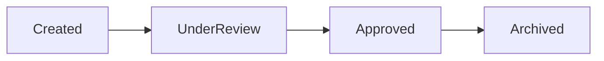

### Процесс — среда операций

Процесс — это не просто последовательность шагов. Это среда, в которой определены:

- какие объекты можно использовать;
- какие операции разрешены;
- какие роли выполняют действия;
- какие предусловия должны быть выполнены;
- какие события могут быть опубликованы;
- куда объект может быть передан дальше.

Пример:

`Процесс согласования заявления`

может разрешать:

`read, comment, approve, reject, requestChanges`

но не разрешать:

`delete, publishToPublic, createContract`

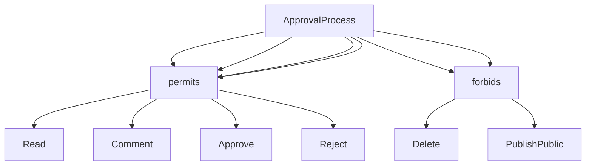

### Событие — атомарный факт

Событие — это не «действие» и не «состояние». Это зафиксированный факт, что **что-то уже произошло**.

Примеры:

- `Заявление_17 создано`
- `Заявление_17 отправлено на согласование`
- `Заявление_17 утверждено`
- `Заявление_17 передано в архив`

Формально:

`e = objectId, eventType, payload, timestamp, sourceProcess`

Событие не меняет объект напрямую. Оно **фиксирует**, что изменение уже произошло.

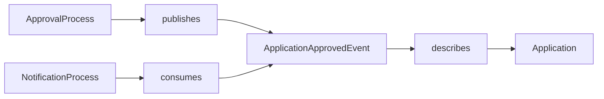

### Межпроцессное взаимодействие

Процессы не обязаны напрямую изменять объекты друг друга. Они могут взаимодействовать через:

- передачу ответственности;
- ссылку на объект;
- подписку на события;
- публикацию события;
- создание производного объекта;
- блокировку или резервирование;
- версионирование и слияние.

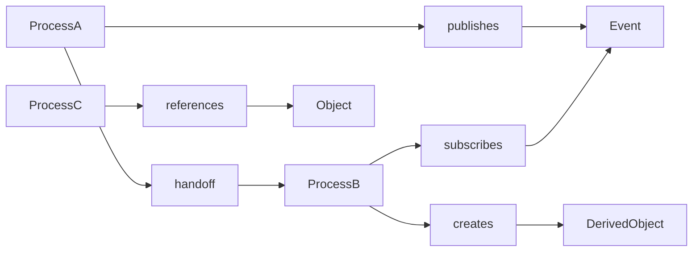

## 4. Состояния и события: как не усложнять теорию

Добавление «множества состояний» **не обязано усложнять теорию**, если не делать его глобальным.

Плохой вариант — один общий список состояний для всех объектов:

`S = {создано, согласовано, утверждено, активно, закрыто, удалено, …}`

Это быстро становится противоречивым: состояние `согласовано` имеет смысл для заявления, но не для физического предмета или платежа.

Лучше определить состояния **по типу объекта**:

`States : O → ℘S`

где `℘S` — множество всех подмножеств `S`.

То есть:

`States(Заявление) = {создано, на_согласовании, согласовано, утверждено, отклонено, архивировано}`

`States(Договор) = {черновик, на_согласовании, подписан, расторгнут}`

`States(Материал) = {на_складе, зарезервирован, выдан, израсходован}`

А сам объект хранит лишь текущее состояние:

`o.state ∈ States(type(o))`

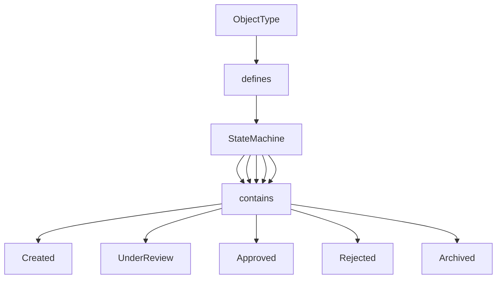

## События: один факт — много интерпретаций

Вы правильно заметили: одно и то же событие может быть важно для нескольких процессов.

Например:

`Заявление_17 утверждено`

может быть интересно:

- процессу уведомлений;
- процессу архивирования;
- процессу формирования приказа;
- процессу бухгалтерского учёта;
- процессу контроля сроков.

Но **событие не принадлежит процессу**. Оно принадлежит объекту или предметной области, а процессы лишь подписываются на него.

Формально:

`Event = objectId, eventType, payload, timestamp, sourceProcess`

Подписка:

`Subscription = subscriberProcess, eventPattern, handler`

Тогда:

`on e ∈ eventPattern ⇒ handler(subscriberProcess, e)`

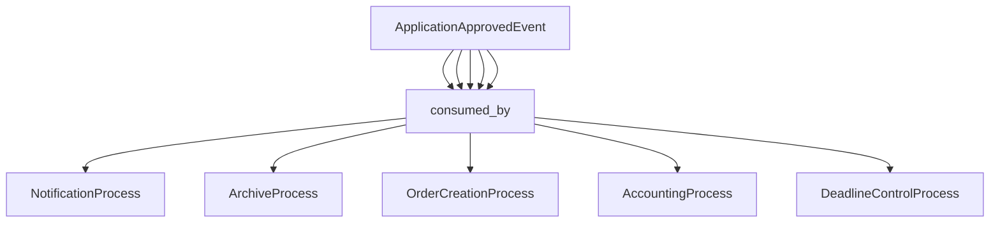

Это не означает, что каждый процесс «содержит» событие. Каждый процесс имеет **собственную проекцию** события:

`view(p, e) = relevantInformationFor(p, e)`

Например:

- для уведомлений важны заявитель и канал связи;
- для архива важны срок хранения и категория документа;
- для бухгалтерии важны сумма, статья расходов и контрагент;
- для контроля сроков важны дедлайн и ответственный.

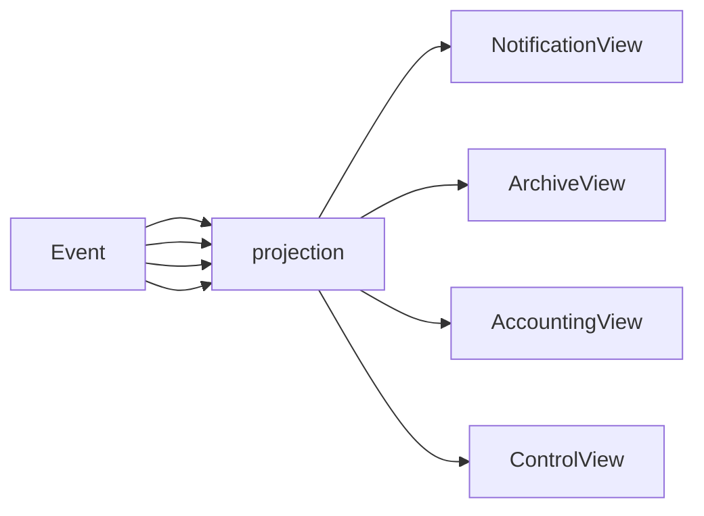

## Одинаковые операции в разных процессах

Вы также правы: разные процессы могут иметь одинаковые операции, как функции в ARIS. Например, `согласовать`, `утвердить`, `зарегистрировать`, `архивировать` могут повторяться.

Поэтому операцию нужно отделить от процесса.

`Operation = operationType, preconditions, effects, permissions, eventTemplate`

Процесс не определяет операцию заново, а **использует** её с собственной конфигурацией:

`ProcessOperation = process, operation, role, rules, eventMapping`

Пример:

| Операция | Процесс согласования | Процесс утверждения | Процесс архивирования |
|---|---|---|---|
| `approve` | Переводит в `согласовано` | Переводит в `утверждено` | Не используется |
| `archive` | Не используется | Может быть разрешена | Переводит в `архивировано` |
| `read` | Разрешена | Разрешена | Разрешена |
| `comment` | Разрешена | Разрешена | Обычно запрещена |

Формально:

`can(p, o, a) = permissionPolicy(p, o, a) ∧ stageAllows(p, a) ∧ roleAllows(actor, a)`

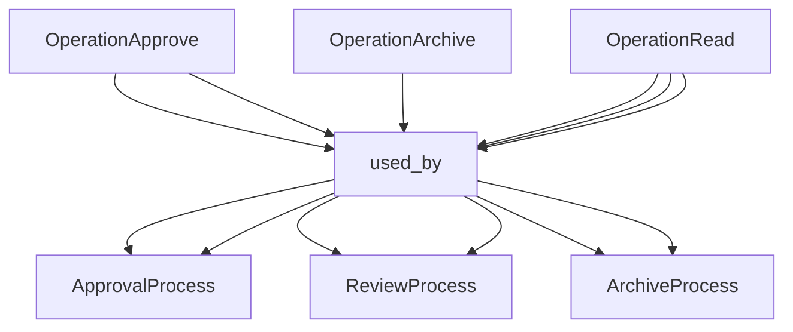

## Варианты учёта событий

Есть три практичных варианта. Их можно комбинировать.

### Вариант A: события принадлежат объекту

Событие привязано к жизненному циклу объекта:

`events(o) = (e₁, e₂, …, eₙ)`

Любой процесс может подписаться, но не становится владельцем события.

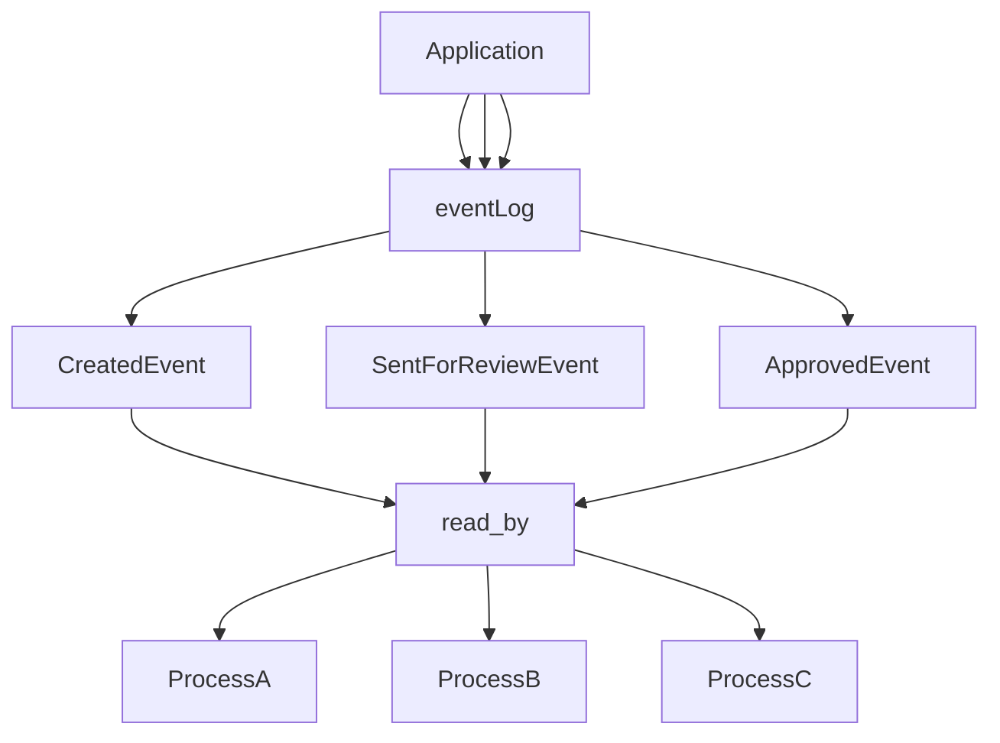

Плюс: простая история и аудит.  
Минус: при очень большом числе процессов журнал становится перегруженным.

### Вариант B: события принадлежат процессу

Каждый процесс публикует собственные события:

`events(p) = (e₁, e₂, …, eₙ)`

Другие процессы подписываются на события конкретного процесса.

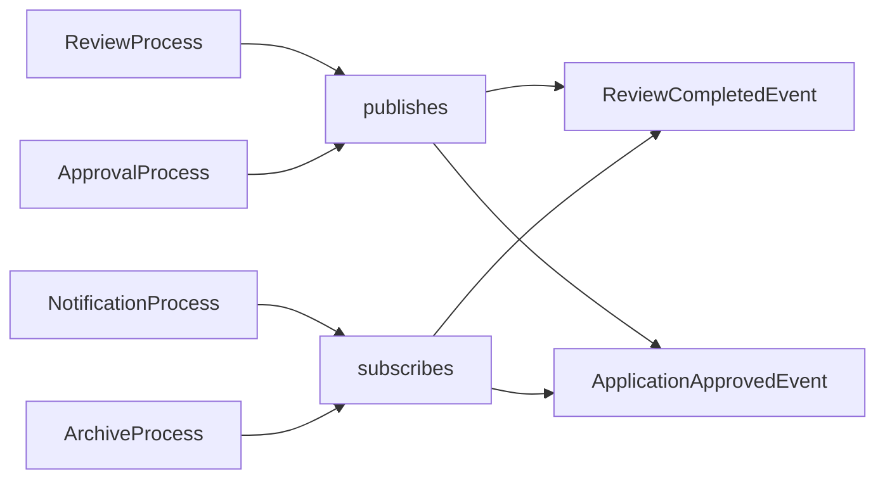

Плюс: понятна ответственность за публикацию.  
Минус: труднее получить единую историю объекта, если события разбросаны по процессам.

### Вариант C: события принадлежат предметной области

Есть общий журнал доменных событий:

`DomainEventLog`

Каждое событие содержит:

`objectId, eventType, sourceProcess, timestamp, payload`

Процессы не владеют событиями, а лишь являются их источниками или потребителями.

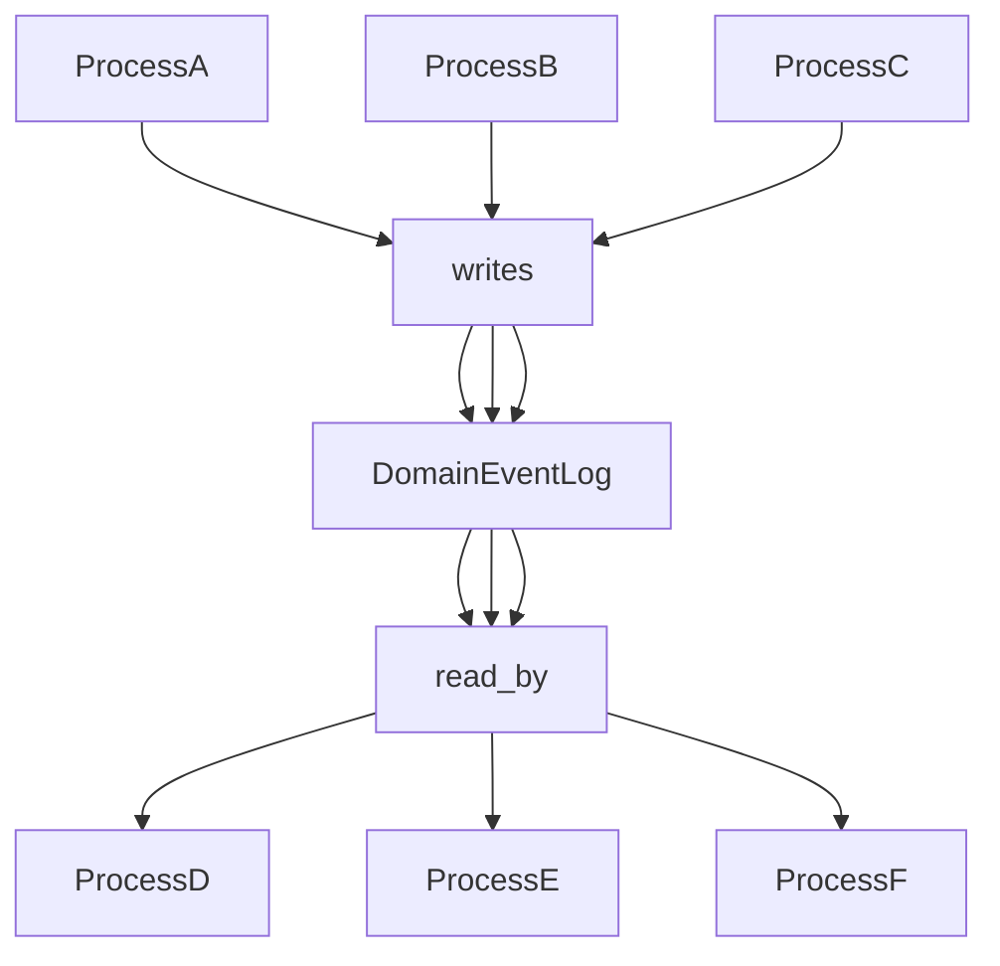

Плюс: единая история, независимость процессов, хорошая масштабируемость.  
Минус: нужна инфраструктура событий и соглашения о схемах событий.

**Рекомендация:** используйте вариант C как основной, а вариант A — как проекцию: для каждого объекта можно построить его историю из общего журнала:

`history(o) = filter(DomainEventLog, e.objectId = o.id)`

## Обновлённая формальная модель

Базовые сущности:

- `O` — типы объектов.
- `P` — типы процессов.
- `I` — идентификаторы.
- `T` — моменты времени.
- `S` — универсум возможных состояний.
- `A` — типы операций.
- `E` — типы событий.
- `R` — роли.
- `U` — пользователи или агенты.

Экземпляр объекта:

`o(t) = id, type, state, attrs, custodian, responsibleProcess, version, lifecycle`

где:

`state ∈ States(type(o))`

`custodian ∈ U ∪ OrgUnit ∪ System`

`responsibleProcess ∈ P ∪ {∅}`

Экземпляр процесса:

`π(t) = pid, ptype, stage, participants, context, activeObjects`

Операция:

`a = operationType, preconditions, effects, permissions, eventTemplate`

Право на операцию:

`can(actor, o, a, p, t) = roleAllows(actor, a) ∧ policyAllows(p, o, a) ∧ stageAllows(p, a) ∧ preconditions(o, a)`

Событие:

`e = eventId, objectId, eventType, payload, timestamp, sourceProcess, actor`

Публикация:

`publish(p, o, e) ⇒ DomainEventLog ← DomainEventLog ∪ {e}`

Подписка:

`subscribe(p₂, pattern, handler)`

Обработка:

`e ∈ pattern ⇒ handler(p₂, e)`

## Схема полной модели

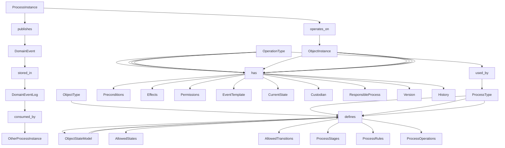

## Операции внутри процесса

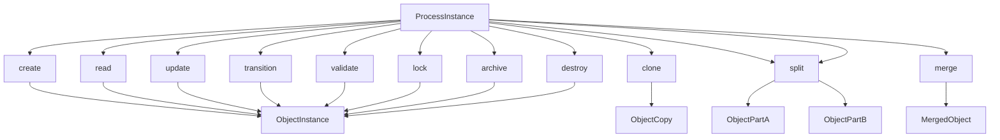

Пример:

`Согласование_заявления` создаёт объект:

`create(Согласование_заявления, Заявление, attrs)`

Затем меняет состояние:

`transition(Согласование_заявления, Заявление_17, на_согласовании)`

И публикует событие:

`publish(Согласование_заявления, Заявление_17, заявление_отправлено_на_согласование)`

## Операции между процессами

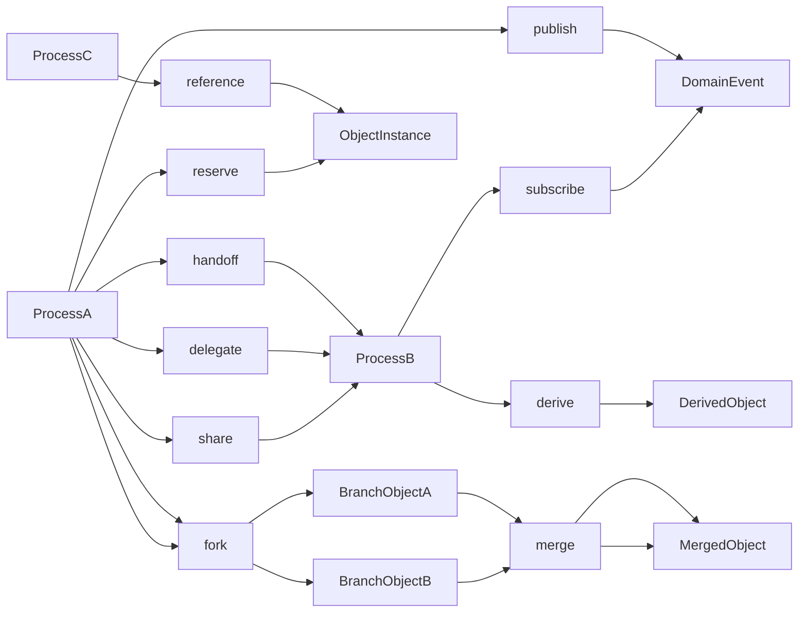

### Передача ответственности

`handoff(p₁, p₂, o)`

Процесс `p₁` прекращает быть ответственным за объект, а `p₂` становится ответственным.

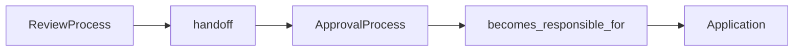

### Делегирование прав

`delegate(p₁, p₂, o, rights)`

`p₁` остаётся ответственным, но `p₂` получает ограниченные права.

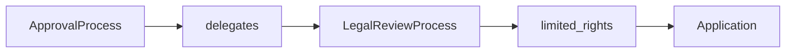

### Совместная работа

`share(p₁, p₂, o, rights, conflictPolicy)`

Оба процесса видят объект, но изменения регулируются политикой.

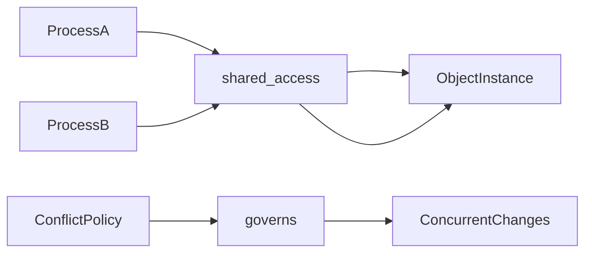

### Публикация и подписка

`publish(p₁, o, e)`  
`subscribe(p₂, pattern, handler)`

```mermaid
flowchart LR
    ApprovalProcess --> publishes --> ApplicationApprovedEvent
    ApplicationApprovedEvent --> consumed_by --> NotificationProcess
    ApplicationApprovedEvent --> consumed_by --> ArchiveProcess
    ApplicationApprovedEvent --> consumed_by --> OrderCreationProcess
```

### Производный объект

`derive(p₂, o, rule) → o′`

```mermaid
flowchart LR
    Application --> source_of --> Order
    ApprovalProcess --> creates --> Order
    Order --> references --> Application
```

### Ссылка без копирования

`reference(p₂, o)`

```mermaid
flowchart LR
    ObjectInstance --> referenced_by --> ProcessC
    ProcessC --> stores --> Reference
    Reference --> points_to --> ObjectInstance
```

### Форк и слияние

`fork(p, o) → o₁, o₂`  
`merge(p, o₁, o₂, conflictPolicy) → o₃`

```mermaid
flowchart TD
    OriginalObject --> fork --> BranchA
    OriginalObject --> fork --> BranchB
    BranchA --> merge --> MergedObject
    BranchB --> merge --> MergedObject
```

## Уточнённая итоговая формулировка

Ваша теория может звучать так:

> **Объект — это идентифицируемая сущность, сохраняющая идентичность во времени и обладающая типизированным жизненным циклом. Процесс — это авторизованная среда выполнения операций над объектами. Состояние объекта локально для его типа. Событие — атомарный зафиксированный факт, порождённый процессом и относящийся к объекту. Разные процессы могут читать, интерпретировать и реагировать на одно и то же событие. Межпроцессное взаимодействие осуществляется через передачу ответственности, делегирование прав, совместный доступ, ссылки, публикации, подписки, производные объекты, версионирование и политики разрешения конфликтов.**

Это лучше прежней формулировки, потому что:

- не предполагает, что объект принадлежит процессу;
- разделяет ответственность, права и участие;
- делает состояния локальными для типа объекта;
- позволяет одному событию иметь много потребителей;
- допускает повторное использование одинаковых операций разными процессами;
- не требует заранее фиксировать все события в каждом процессе.
