## 1
Рассмотри такой вариант.  
fun – это атомарная операция (функция) над объектом, т.е. аргумент функции (id объекта и его состояние), также может быть несколько других объектов. Однако при выполнении такой «атомарной» функции происходит изменение состояния только одного объекта.   
Если требуется менять несколько, то требуется несколько функций, т.е. декомпозиция. Т.е. аргументы – несколько объектов, значение функции – только один, причем из состава аргументов, но с новым состоянием.  
Функция fun – комплексная функция, в ней вводится мнимая составляющая – события. Т.е. аргументом функции также является набор событий (из множества событий) и на выходе функции – тоже событие (ровно одно).  
Математически это аналог мнимой единицы, но тут «возведении в квадрат даёт -1» - не при чем, а лишь показывает комплексное сочетание объектного и событийного входа. 

---

Ваш вариант содержателен, но его лучше немного скорректировать: идея **одного изменяемого объекта на одну атомарную операцию** — сильный и полезный инвариант. Однако событие лучше не называть «мнимой составляющей», а формализовать как отдельный тип результата: операция возвращает **одно изменение состояния** и **один исход события**. Это ближе к CQRS/event sourcing, сетям Петри и алгебраическим эффектам, чем к комплексным числам. [link.springer](http://link.springer.com/content/pdf/10.1007/978-3-030-43946-0_7)

## Близкие подходы

| Подход | Общая идея | Что подходит вашей модели | Что нужно скорректировать |
|---|---|---|---|
| **Сети Петри** | Переход срабатывает атомарно: потребляет токены из входных мест и создаёт токены в выходных.  [link.springer](http://link.springer.com/content/pdf/10.1007/978-3-030-43946-0_7) | Атомарность перехода, входные объекты-условия, выходной результат | В Петри токены обычно анонимны; вам нужны идентификаторы и состояния объектов |
| **CQRS + Event Sourcing** | Команда обрабатывается агрегатом, который порождает события; события фиксируют изменения состояния.  [learn.microsoft](https://learn.microsoft.com/ru-ru/previous-versions/msp-n-p/jj591577(v=pandp.10)) | `команда → проверка → одно событие → новое состояние` | Команда и событие — разные вещи: команда является намерением, событие — фактом |
| **Алгебраические эффекты** | Операция объявляет эффект, а обработчик определяет его семантику; эффекты можно композиционно разделять.  [microsoft](https://www.microsoft.com/en-us/research/wp-content/uploads/2016/08/algeff-tr-2016-v2.pdf) | Разделение объектного изменения и событийного эффекта | Лучше не «мнимая часть», а типизированный эффект `emit(event)` |
| **State monad** | Функция получает состояние и возвращает результат вместе с новым состоянием. | `fun : состояние → результат × новое состояние` | Нужен отдельный канал для публикуемого события |
| **Multiset rewriting** | Правило переписывает мультимножество ресурсов: одни ресурсы потребляются, другие создаются.  [pages.di.unipi](https://pages.di.unipi.it/milazzo/teaching/AA1920-CMCS/slides/11-PetriNets.pdf) | Несколько объектов на входе, один объект-результат | Ваше ограничение «меняется только один объект» — дополнительное правило, а не свойство самой перезаписи |

## Ваша исходная идея

Вы предлагаете примерно следующее:

`fun(o₁, o₂, …, oₙ, e₁, e₂, …, eₖ) → o′`

где:

- `o₁, …, oₙ` — объекты-аргументы;
- `e₁, …, eₖ` — входные события;
- `o′` — один объект из аргументов, но с новым состоянием.

То есть:

`fun : O × O × … × O × E × E × … × E → O`

При этом изменяется состояние только одного объекта:

`changed(o′) = один объект`

А событие вы вводите как «мнимую» составляющую:

`fun(o₁, …, oₙ, e₁, …, eₖ) → o′ + e′`

где `e′` — ровно одно выходное событие.

Это можно записать так:

`fun : Oⁿ × Eᵏ → O × E`

## Что в этой идее правильно

### Одно изменение за операцию

Это очень хорошее правило. Оно делает модель предсказуемой:

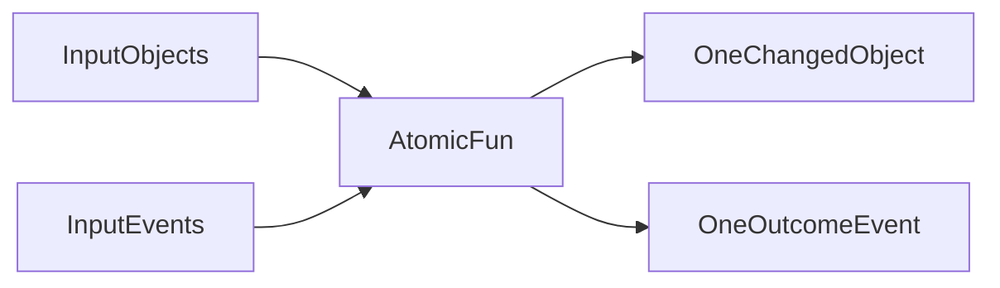

Например:

`утвердить(Заявление_17, Решение_согласования) → Заявление_17_утверждено`

Здесь:

- читаются `Заявление_17` и `Решение_согласования`;
- изменяется только `Заявление_17`;
- публикуется одно событие `заявление_утверждено`.

### Событие как отдельный результат

Тоже правильно. Событие не должно быть «спрятано» внутри изменения состояния: его нужно сделать явным результатом операции.

Иначе нельзя ответить на вопросы:

- кто и когда узнал об изменении;
- какие процессы должны отреагировать;
- было ли изменение успешным;
- было ли изменение отклонено;
- какие факты уже зафиксированы.

В event sourcing агрегат при обработке команды создаёт событие, которое одновременно фиксирует изменение состояния и может уведомить другой ограниченный контекст. [learn.microsoft](https://learn.microsoft.com/ru-ru/previous-versions/msp-n-p/jj591577(v=pandp.10))

## Главная корректировка

Я бы разделил три разных понятия:

| Понятие | Что это | Пример |
|---|---|---|
| **Команда / запрос** | Намерение выполнить действие | `Утвердить заявление №17` |
| **Операция `fun`** | Атомарное правило обработки | `approve(application, approvalDecision)` |
| **Событие** | Уже произошедший факт | `Заявление №17 утверждено` |

Тогда операция получает не обязательно события, а **факты или команды**. Если на входе уже события, то операция является реактивной:

`on event → change state → emit event`

Если на входе команда, то операция является императивной:

`command → validate → change state → emit event`

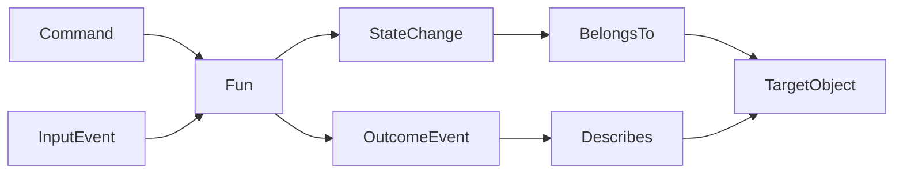

## Предлагаемая сигнатура `fun`

Вместо:

`fun : Oⁿ × Eᵏ → O × E`

предлагаю:

`fun : Target × Context × Facts → ΔState × OutcomeEvent`

где:

- `Target` — ровно один изменяемый объект;
- `Context` — другие объекты, которые можно только читать;
- `Facts` — входные события, команды или факты;
- `ΔState` — изменение состояния целевого объекта;
- `OutcomeEvent` — ровно одно выходное событие.

Более строго:

`fun : O × ℘O × ℘E → ΔS × E`

где:

- первый `O` — целевой объект;
- `℘O` — множество контекстных объектов;
- `℘E` — множество входных фактов или событий;
- `ΔS` — изменение состояния;
- `E` — одно выходное событие.

## Ограничение одного объекта

Ваше правило можно записать так:

`changed(fun) = target(fun)`

То есть:

`∀o ∈ context(fun): state(o) = state(o) до fun`

`state(target(fun)) ≠ state(target(fun)) до fun`

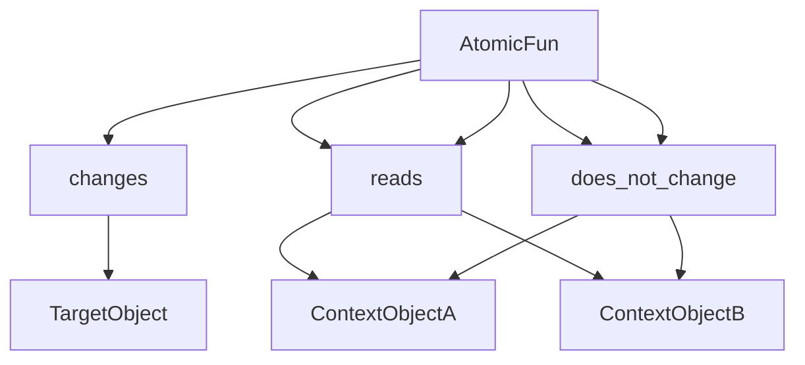

Пример:

`зарегистрировать_платёж(Заявка_17, Платёж_42) → Заявка_17_оплачена`

- изменяется только `Заявка_17`;
- `Платёж_42` читается как контекст;
- публикуется одно событие `заявка_оплачена`.

Но если нужно изменить и заявку, и платёж, то по вашему правилу нужны две операции:

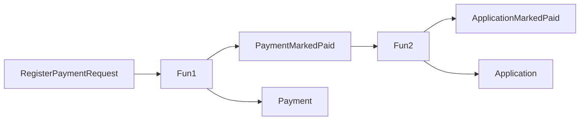

Это не недостаток, а полезное свойство: сложное действие становится **цепочкой атомарных фактов**, а не одним непрозрачным изменением.

## Нужно ли всегда одно выходное событие?

**Не обязательно.** Лучше разрешить три исхода:

`OutcomeEvent ∈ E ∪ {∅} ∪ Eᵏ`

То есть операция может:

- не публиковать событие;
- публиковать одно событие;
- публиковать несколько событий.

Но если вам важна максимальная простота и трассируемость, можно принять более сильное правило:

`каждая fun публикует ровно одно событие`

Тогда даже отказ нужно фиксировать как событие:

`заявление_не_утверждено`  
`операция_отклонена`  
`недостаточно_прав`  
`объект_уже_утверждён`

Это удобно для аудита, но может породить много технических событий. Практичный компромисс:

`fun возвращает 0 или 1 доменное событие`  
`ошибки и отклонения фиксируются отдельным журналом операций`

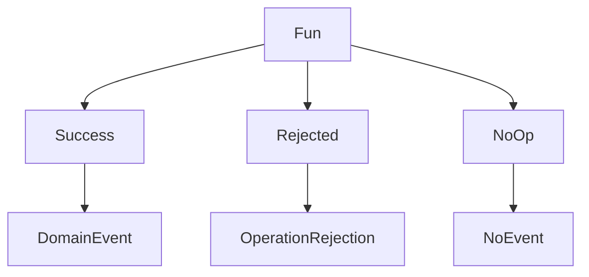

## Что делать с несколькими объектами

Ваше правило «меняется только один объект» хорошо работает, если различать:

- **целевой объект** — тот, чьё состояние меняется;
- **контекстные объекты** — те, которые читаются;
- **зависимые объекты** — те, которые должны измениться позже;
- **производные объекты** — те, которые создаются как новый результат.

Пример: утверждение заявления может потребовать:

1. изменить заявление;
2. создать приказ;
3. изменить статус договора;
4. уведомить заявителя.

По вашему правилу это четыре отдельные `fun`:

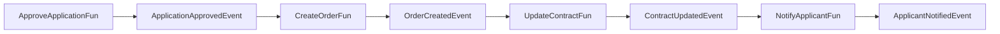

Это resembles событийно-управляемую цепочку: каждая операция изменяет один объект и порождает факт для следующей.

## Корректировка «мнимой составляющей»

Метафора с мнимой единицей наглядна, но математически она может ввести в заблуждение: в комплексных числах `i² = -1`, а здесь такого свойства нет.

Лучше использовать **размеченное объединение** или **пару**:

`Result = ΔState × Event`

То есть результат операции — это не «объект плюс мнимая часть», а пара:

`результат = изменение состояния + опубликованный факт`

Можно обозначить это так:

`fun(o, C, F) = (Δs, e)`

где:

- `o` — целевой объект;
- `C` — контекстные объекты;
- `F` — входные факты;
- `Δs` — изменение состояния;
- `e` — выходное событие.

Если хотите сохранить вашу метафору, назовите её не «мнимой составляющей», а **событийной проекцией операции**:

`fun = objectEffect ⊕ eventEffect`

где `⊕` — не сложение чисел, а композиция двух независимых эффектов.

## Предлагаемое определение `fun`

Атомарная операция:

`fun = id, name, targetSpec, contextSpec, inputSpec, precondition, stateEffect, eventEffect, permissions`

Формально:

`fun : O × ℘O × ℘F → ΔS × E?`

где:

- `O` — целевой объект;
- `℘O` — контекстные объекты;
- `℘F` — входные факты, команды или события;
- `ΔS` — изменение состояния;
- `E?` — ноль или одно событие.

Если вы хотите строгого правила «ровно одно событие»:

`fun : O × ℘O × ℘F → ΔS × E`

## Пример: утверждение заявления

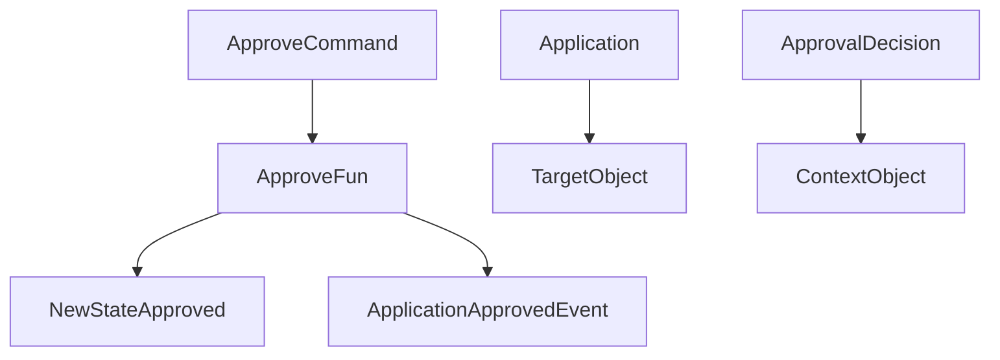

Формально:

`fun_утвердить(Заявление_17, {Решение_согласования}, {команда_утвердить}) = (Δstate, заявление_утверждено)`

Где:

`Δstate: на_согласовании → утверждено`

Итог:

`state(Заявление_17, t′) = утверждено`

`events(Заявление_17, t′) = events(Заявление_17, t) ∪ {заявление_утверждено}`

## Пример: передача объекта

Передача объекта из процесса `p₁` в `p₂` — хороший тест для вашего правила.

Если считать передачу одной операцией, то меняются два объекта:

- процесс `p₁` перестаёт быть ответственным;
- процесс `p₂` становится ответственным.

Но можно сохранить ваше правило, если **объект один**, а меняется его атрибут `responsibleProcess`:

`handoff(p₁, p₂, o) → o′`

где:

`o′.responsibleProcess = p₂`

Тогда:

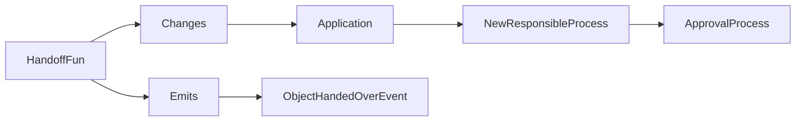

Формально:

`fun_передать(Заявление_17, {Процесс_согласования, Процесс_утверждения}, {команда_передать}) = (Δstate, объект_передан)`

Здесь изменяется **один объект** — заявление, а не два процесса. Процессы являются контекстом операции.

## Пример: резервирование материала

`резервировать(Материал_5, Заявка_17) → Материал_5_зарезервирован`

- целевой объект: `Материал_5`;
- контекстный объект: `Заявка_17`;
- выходное событие: `материал_зарезервирован`.

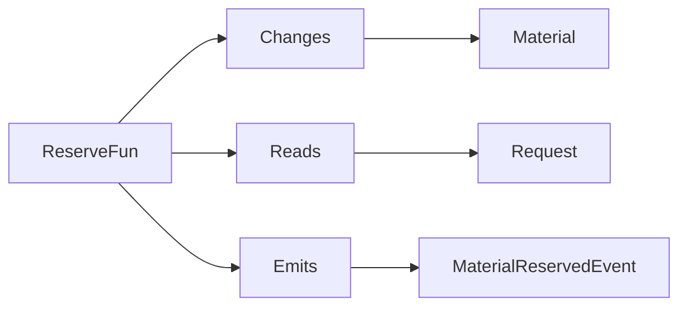

Если одновременно нужно изменить и материал, и заявку, то нужны две операции:

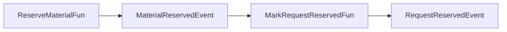

## Событие как вход и выход

Здесь важно различить два случая.

### Событие на входе

Событие на входе — это уже произошедший факт:

`on заявление_согласовано → fun_утвердить`

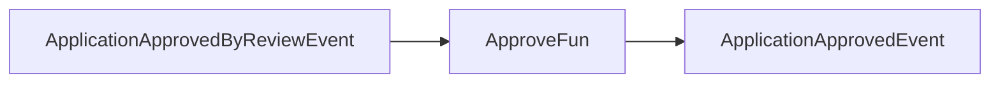

### Событие на выходе

Событие на выходе — это новый зафиксированный факт:

`fun_утвердить → заявление_утверждено`

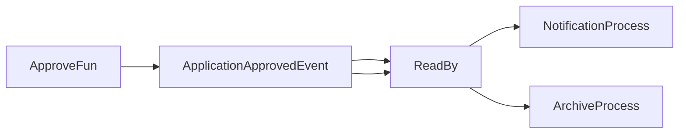

### Событие одновременно на входе и выходе

Это нормальная ситуация: операция реагирует на факт и порождает новый факт.

`заявление_согласовано → fun_утвердить → заявление_утверждено`

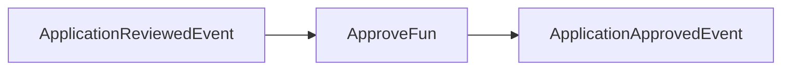

Но событие на входе не обязательно должно быть событием **того же объекта**. Например:

`платёж_получен → fun_закрыть_заявку → заявка_закрыта`

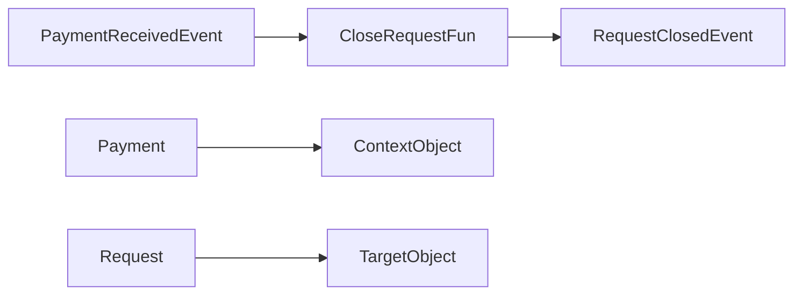

## Как учитывать одни и те же операции в разных процессах

Операцию нужно определить один раз, а процесс лишь задаёт её конфигурацию.

`fun_утвердить` может использоваться:

- в процессе согласования;
- в процессе утверждения;
- в процессе рассмотрения жалобы;
- в процессе контроля качества.

Но у каждого процесса могут быть разные:

- предусловия;
- роли;
- права;
- допустимые переходы;
- шаблон события;
- обязательные контекстные объекты.

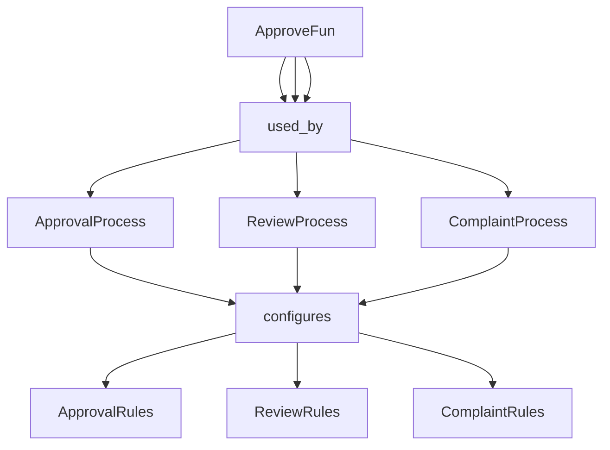

Формально:

`ProcessFun = process, fun, role, stage, preconditionExtension, eventMapping`

Тогда:

`can(actor, p, fun, o) = roleAllows(actor, fun) ∧ stageAllows(p, fun) ∧ policyAllows(p, o, fun)`

## Итоговая модель

Предлагаю такую формулу:

`fun : Target × Context × Input → StateChange × Outcome`

где:

`Target = O`  
`Context ⊆ O`  
`Input ⊆ F`  
`StateChange = ΔS`  
`Outcome = E?`

А при строгом правиле «ровно одно событие»:

`fun : O × ℘O × ℘F → ΔS × E`

Ключевые правила:

1. У каждой `fun` есть ровно один **целевой объект**.
2. Контекстные объекты могут читаться, но не изменяются.
3. Изменение состояния целевого объекта атомарно.
4. Операция может опубликовать ноль или одно доменное событие; при строгом варианте — ровно одно.
5. Если нужно изменить несколько объектов, это декомпозируется в цепочку `fun`.
6. Событие на входе — факт, вызвавший операцию; событие на выходе — факт, зафиксировавший её результат.
7. Одна и та же `fun` может использоваться разными процессами с разными правами, предусловиями и шаблонами событий.

## Полная схема

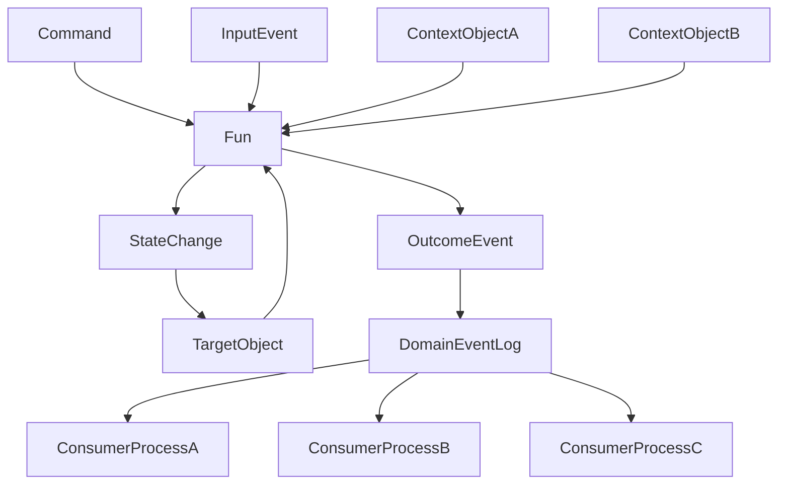

## Практическое правило

Я бы принял такую дисциплину:

> **Одна `fun` изменяет состояние ровно одного целевого объекта, читает любое число контекстных объектов, принимает ноль или более входных фактов и публикует ноль или одно доменное событие. Если требуется изменить несколько объектов, это не одна `fun`, а согласованная цепочка `fun`, где выходное событие предыдущей операции является входным фактом следующей.**

Это сохраняет вашу основную идею, но делает её более точной и реализуемой. Сети Петри подтверждают ценность атомарного перехода: он потребляет входные токены и создаёт выходные как единый шаг.  CQRS и event sourcing подтверждают разделение команды, изменения состояния и публикуемого события.  Алгебраические эффекты дают более корректную альтернативу «мнимой составляющей»: событие — это явный эффект операции, а не её скрытая часть. [link.springer](http://link.springer.com/content/pdf/10.1007/978-3-030-43946-0_7)
