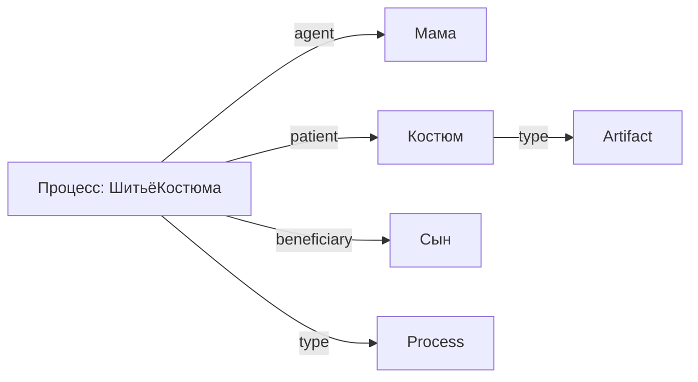

## 1
**Прямое дополнение** — это второстепенный член предложения, который обозначает предмет, на который непосредственно направлено действие. Оно отвечает на вопросы винительного падежа: *кого? что?*. [```1```](https://gramota.ru/biblioteka/spravochniki/russkij-yazyk-kratkij-teoreticheskij-kurs-dlya-shkolnikov/prostye-predlozheniya-vtorostepennye-chleny-predlozheniya)[```8```](https://www.yaklass.by/p/russkij-yazyk/8-klass/dvusostavnye-predlozheniia-3908/vtorostepennye-chleny-predlozheniia-3913/re-9fc33d91-e171-46ac-8c4e-5a8b644d3fcf)[```2```](https://foxford.ru/wiki/russkiy-yazyk/dopolnenie-pryamoe-i-kosvennoe-dopolnenie)

## Как выражается прямое дополнение

Чаще всего прямое дополнение выражается **формой винительного падежа без предлога**:
* *Я прочитал **книгу*** (прочитал что? — книгу).
* *Она купила **машину*** (купила что? — машину).

**Но есть и другие случаи:**
* **Родительный падеж без предлога** при наличии отрицания: *Илья не читал **письма***.
* **Родительный падеж** при переходных глаголах, которые совмещают значение достижения результата с количественным значением (указание на часть целого): *Пойду куплю **хлеба***.
* **Родительный падеж** при некоторых наречиях-сказуемых в безличных предложениях: *Мне жаль **потраченного времени***.

 [```8```](https://www.yaklass.by/p/russkij-yazyk/8-klass/dvusostavnye-predlozheniia-3908/vtorostepennye-chleny-predlozheniia-3913/re-9fc33d91-e171-46ac-8c4e-5a8b644d3fcf)[```1```](https://gramota.ru/biblioteka/spravochniki/russkij-yazyk-kratkij-teoreticheskij-kurs-dlya-shkolnikov/prostye-predlozheniya-vtorostepennye-chleny-predlozheniya)

## Важный нюанс

Прямое дополнение связано с **переходными глаголами** — такими, которые способны присоединять прямое дополнение (действие полностью переходит на предмет). Непереходные глаголы не могут иметь прямого дополнения. [```2```](https://foxford.ru/wiki/russkiy-yazyk/dopolnenie-pryamoe-i-kosvennoe-dopolnenie)

## Как не перепутать с подлежащим

Формы именительного и винительного падежей у существительных иногда совпадают. Чтобы определить прямое дополнение, нужно задать вопрос от сказуемого и убедиться, что действие переходит на предмет. [```3```](https://www.yaklass.ru/p/russky-yazik/5-klass/sintaksis-prostoe-dvusostavnoe-predlozhenie-7153293/vtorostepennye-chleny-predlozheniia-7201277/re-08580a6e-29fc-4cc7-aaf9-d985b137b474)

* *Шмель опыляет **цветок*** (опыляет что? цветок — прямое дополнение, так как на него переходит действие).
* *Мать любит **дочь*** (любит кого? дочь — прямое дополнение).

Если у вас остались вопросы по примерам или нужно разобрать другое предложение — спрашивайте!

## 1.1

В RDF связь в триплете задаётся **предикатом** — это как раз то, что соединяет субъект и объект, обозначая тип отношения между ними.

## Как устроена связь в RDF‑триплете

Триплет имеет структуру **«субъект — предикат — объект»** и формально выражает утверждение о ресурсе.

- **Субъект** — о чём идёт речь (ресурс, который описывают; всегда URI или пустой узел).
- **Предикат** — тип связи/свойства (всегда URI); именно он кодирует семантику отношения.
- **Объект** — значение свойства или другой ресурс (URI, пустой узел или литерал).

### Пример на Turtle

```turtle
@prefix ex: <http://example.org/> .
ex:Алиса ex:любит ex:кофе .
```

Здесь:
- субъект: `ex:Алиса`;
- предикат: `ex:любит` — это и есть **связь** («любит»);
- объект: `ex:кофе`.

Графово это выглядит как ребро с меткой `любит`, идущее от узла «Алиса» к узлу «кофе».

---

## Примеры разных типов связей

Разные предикаты кодируют разные виды отношений:

- принадлежность к классу:  
  `ex:Алиса rdf:type ex:Человек .`  
  (связь «является экземпляром класса»).
- авторство:  
  `ex:Книга1 dc:creator ex:Автор1 .`  
  («создано кем»).
- иерархические связи (из RDFS):  
  `ex:Собака rdfs:subClassOf ex:Млекопитающее .`  
  («является подклассом»).
- свойства со значениями:  
  `ex:Алиса foaf:age "30"^^xsd:integer .`  
  (связь «имеет возраст», объект — литерал).

---

## Связь с онтологиями и логикой

Учитывая ваш интерес к онтологиям (SUMO, OWL и т. д.), важно: предикат может быть не просто «бытовым» отношением, а термином из онтологии, у которого есть семантика и ограничения. Например:

- `rdfs:domain` и `rdfs:range` задают, к каким классам могут относиться субъект и объект для данного предиката.
- В OWL можно дополнительно описать транзитивность, симметричность и другие свойства связи.

Так, если задано:
```turtle
ex:родитель rdfs:domain ex:Человек ;
            rdfs:range ex:Человек .
```
то система «понимает», что связь `ex:родитель` соединяет только людей.

---

## Графовая интерпретация

Совокупность триплетов образует **ориентированный размеченный граф**:
- вершины (узлы) — субъекты и объекты;
- рёбра (дуги) — предикаты, то есть сами связи;
- метка ребра — URI предиката, определяющий смысл отношения.

Это удобно, когда нужно моделировать онтологии и сложные сети знаний: каждая связь — это отдельное утверждение, которое можно комбинировать, запрашивать через SPARQL и расширять без изменения общей схемы.

---

## Пример с онтологической связью (в духе ваших задач по SUMO/OWL)

Допустим, хотим выразить: «Алиса — физическое существо (PhysicalEntity) в SUMO»:

```turtle
@prefix sumo: <http://www.ontologyportal.org/SUMO.owl#> .
@prefix ex: <http://example.org/> .

ex:Алиса rdf:type sumo:PhysicalEntity .
```

Связь здесь — предикат `rdf:type`, а смысл отношения уточняется через класс `sumo:PhysicalEntity` из онтологии SUMO.

## 1.2 
Объект тут это и есть прямое дополнение? 

Короткий ответ: **не совсем**. Объект в RDF‑триплете и прямое дополнение в грамматике — это похожие по роли вещи, но из разных систем (семантические данные vs. синтаксис предложения).

## В чём сходство

В обоих случаях это «то, на что направлено действие/отношение»:

- В русском предложении: *«Мама любит дочку»* → «дочку» — прямое дополнение (на неё направлено действие «любит»).
- В RDF: `ex:Мама ex:любит ex:Дочка` → `ex:Дочка` — объект триплета (на него указывает отношение «любит»).

Поэтому при моделировании знаний часто делают так: **объект RDF берут как аналог прямого дополнения**, если в исходном предложении есть переходный глагол с прямым дополнением.

---

## Где различия

| Критерий | Прямое дополнение (грамматика) | Объект (RDF‑триплет) |
|---|---|---|
| Что это | Синтаксическая роль в предложении | Один из трёх компонентов утверждения о ресурсе |
| На что отвечает | Вопросы «кого? что?» | Может быть URI (ресурс), пустым узлом или литералом (например, строкой или числом) |
| Зависимость | Зависит от глагола и падежа в конкретном языке | Не зависит от языка: структура «субъект–предикат–объект» универсальна |
| Пример | *«Я читаю книгу»* → «книгу» — прямое дополнение | `ex:Я ex:читает ex:Книга` или `ex:Я ex:читает "Война и мир"` (литерал) |

## Важные нюансы для ваших задач (онтологии, формализация)

1. **Не каждое прямое дополнение становится объектом в RDF.** Иногда удобнее менять структуру: например, вместо прямого объекта делать свойство-литерал:  
   *«Алисе 30 лет»* → не `ex:Алиса ex:имеетВозраст ex:30`, а `ex:Алиса foaf:age "30"^^xsd:integer` (объект — литерал).
2. **Объект может быть и не «дополнением».** Например, в `ex:Собака rdfs:subClassOf ex:Млекопитающее` объект `ex:Млекопитающее` — это не дополнение, а класс в иерархической связи.
3. **Предикат задаёт смысл связи.** Именно он решает, какую грамматическую роль мы сопоставляем объекту: «любит» → дополнение, «является» → именная часть сказуемого, «автор» → роль автора и т. п.

### Пример с вашей онтологической стилистикой (Turtle)

```turtle
@prefix ex: <http://example.org/> .
@prefix foaf: <http://xmlns.com/foaf/0.1/> .

ex:Алиса ex:любит ex:Кофе .          # объект ex:Кофе — аналог прямого дополнения
ex:Алиса foaf:age "30"^^xsd:integer . # объект — литерал, не прямое дополнение
ex:Кошка rdfs:subClassOf ex:Животное . # объект — класс, иерархическая связь
```

---

Учитывая ваш интерес к формальным языкам и онтологиям: когда вы переводите предложения в RDF/Turtle, удобно держать такую таблицу соответствий:

- переходные глаголы с прямым дополнением → объект‑ресурс;
- свойства со значениями (возраст, цвет, название) → объект‑литерал;
- отношения типа «вид–род», «часть–целое» → специальные предикаты (rdfs:subClassOf, mereo:hasPart и т. д.), где объект — другой класс или часть.


## 2 

[Мама сшила костюм сыну](https://foxford.ru/wiki/russkiy-yazyk/dopolnenie-pryamoe-i-kosvennoe-dopolnenie)
- Сшила (что?) костюм — прямое дополнение;
- сшила (кому?) сыну — косвенное дополнение.

Разберём фразу *«Мама сшила костюм сыну»* и покажем, как её можно выразить и в виде RDF‑триплетов (для онтологий, семантических баз), и другими форматами — с учётом вашего интереса к формальным языкам, SUMO, Turtle и т. д.

---

## Триплеты (RDF / Turtle)

Здесь важно не пытаться впихнуть всё в один триплет: действие «сшила» лучше моделировать как событие/процесс, а роли (кто, что, кому) — как отдельные связи. Это ближе к онтологической строгости (как в SUMO/BFO).

```turtle
@prefix ex: <http://example.org/> .
@prefix sumo: <http://www.ontologyportal.org/SUMO.owl#> .
@prefix rdf: <http://www.w3.org/1999/02/22-rdf-syntax-ns#> .

# Событие: процесс шитья
ex:ШитьёКостюма_001 rdf:type sumo:Process .
ex:ШитьёКостюма_001 sumo:agent ex:Мама .          # кто совершил действие
ex:ШитьёКостюма_001 sumo:patient ex:Костюм_001 .  # над чем совершено действие (объект, «что сшили»)

# Костюм
ex:Костюм_001 rdf:type sumo:Artifact .

# Получатель: сыну (бенефициар)
ex:ШитьёКостюма_001 ex:beneficiary ex:Сын .
```

### Почему так, а не одним триплетом

- Один триплет `ex:Мама ex:сшила ex:Костюм` теряет роль «сыну» (получателя/бенефициара).
- В онтологиях (SUMO, DOLCE) действия часто моделируют как процессы с несколькими ролями: агент, пациент, бенефициар, инструмент и т. п.
- Предикат `sumo:agent` фиксирует, кто инициировал процесс; `sumo:patient` — над чем процесс совершён; отдельный предикат `ex:beneficiary` — кому предназначено.

Если вы хотите более простой вариант (без отдельного события), можно сделать так:

```turtle
ex:Мама ex:сшила ex:Костюм_001 .
ex:Костюм_001 ex:предназначенДля ex:Сын .
```

Но это менее онтологически строго: теряется временная привязка и семантика процесса.

---

## Не триплетами: другие форматы

### JSON‑LD (удобно для веб‑данных, Linked Data)

```json
{
  "@context": {
    "ex": "http://example.org/",
    "sumo": "http://www.ontologyportal.org/SUMO.owl#",
    "rdf": "http://www.w3.org/1999/02/22-rdf-syntax-ns#"
  },
  "@id": "ex:ШитьёКостюма_001",
  "@type": "sumo:Process",
  "sumo:agent": {"@id": "ex:Мама"},
  "sumo:patient": {"@id": "ex:Костюм_001"},
  "ex:beneficiary": {"@id": "ex:Сын"}
}
```

Это тот же смысл, что и в Turtle, но в JSON‑синтаксисе — удобно для JS‑проектов (как ваш SVG Viewer) и для встраивания в HTML через `<script type="application/ld+json">`.

---

### Mermaid (диаграмма для визуализации связей)

Вы просили визуализацию онтологий и диаграмм — вот Mermaid‑диаграмма для этого случая:



Её можно вставить в Markdown и рендерить в Confluence, GitHub, Notion и т. д., что удобно для документации онтологии.

---

### Логика первого порядка (FOL, с кванторами и предикатами)

С учётом ваших задач по логике и квантификации, то же утверждение можно записать так:

\[
\exists p \, \exists c \, \big( \text{Process}(p) \land \text{Artifact}(c) \land \text{agent}(p, \text{Мама}) \land \text{patient}(p, c) \land \text{beneficiary}(p, \text{Сын}) \big)
\]

Или, если хочется явно связать костюм и процесс:

\[
\exists p \big( \text{Process}(p) \land \text{agent}(p, \text{Мама}) \land \exists c (\text{Artifact}(c) \land \text{patient}(p, c)) \land \text{beneficiary}(p, \text{Сын}) \big)
\]

Здесь:
- `Process`, `Artifact` — классы (унарные предикаты);
- `agent`, `patient`, `beneficiary` — бинарные отношения (предикаты от двух аргументов).

Это соответствует тому, что в логике первого порядка мы квантифицируем по индивидам (процессам, артефактам), но не по свойствам.

---

### RDF/XML (если нужен XML‑формат)

```xml
<rdf:RDF xmlns:rdf="http://www.w3.org/1999/02/22-rdf-syntax-ns#"
         xmlns:ex="http://example.org/"
         xmlns:sumo="http://www.ontologyportal.org/SUMO.owl#">
  <rdf:Description rdf:about="ex:ШитьёКостюма_001">
    <rdf:type rdf:resource="sumo:Process"/>
    <sumo:agent rdf:resource="ex:Мама"/>
    <sumo:patient rdf:resource="ex:Костюм_001"/>
    <ex:beneficiary rdf:resource="ex:Сын"/>
  </rdf:Description>
  <rdf:Description rdf:about="ex:Костюм_001">
    <rdf:type rdf:resource="sumo:Artifact"/>
  </rdf:Description>
</rdf:RDF>
```

---

### Естественный язык с семантической разметкой (LD‑Markdown / аннотации)

Если цель — документация или разметка текста (вы интересовались LD‑Markdown):

> Мама [agent] сшила [action] костюм [patient], предназначенный для сына [beneficiary].

Или с URI:

> [ex:Мама](agent) [ex:сшила](action) [ex:Костюм_001](patient), предназначенный для [ex:Сына](beneficiary).

---

## Как это соотносится с «прямым дополнением»

В предложении *«Мама сшила костюм сыну»*:
- «костюм» — прямое дополнение (отвечает на вопрос «что?»), в RDF это чаще всего `patient` (над чем совершён процесс) или объект простого предиката.
- «сыну» — косвенное дополнение (дательный падеж, «кому?»), в онтологии это отдельная роль: `beneficiary`, `recipient` и т. п., а не прямое дополнение.

Поэтому в формальной модели нельзя просто сказать «объект = прямое дополнение»: у действия может быть несколько ролей, и каждая требует своего предиката.

---

Если скажете, для чего именно нужна эта модель (например, для генерации Mermaid в JS, для SPARQL‑запросов, для статьи по онтологии или для учебного примера по логике), я предложу более узкий и готовый к вставке вариант: полный Turtle‑файл, шаблон JSON‑LD или пример SPARQL, который найдёт такие процессы.

